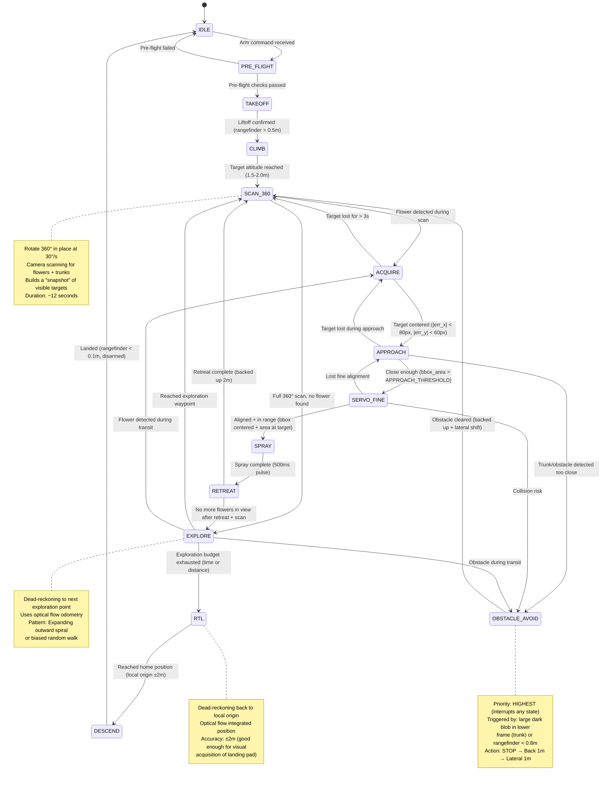
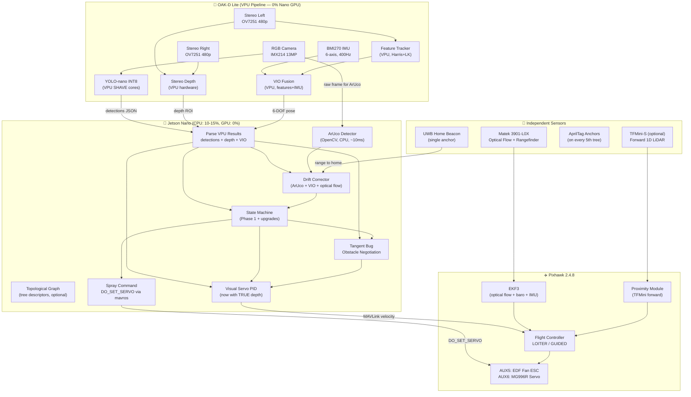

# Behavior-Based Navigation Architecture — "The Blind Drone"
### Date: February 9, 2026
### Phase: Post-Demo Autonomous Navigation (After Optical Flow Integration)
### Prerequisite: ARCHITECTURE_REVIEW.md (Single-Tree Servoing) MUST be working first
### Hardware: Jetson Nano 4GB | Pixhawk 2.4.8 | Matek 3901-L0X | 1D LiDAR | Front USB Camera

---

## 0. DOCUMENT HIERARCHY — WHERE THIS FITS

```
EXECUTION ORDER:
════════════════════════════════════════════════════════

  [Week 1]  ACTION_PLAN_SURVIVAL.md      ← "Can the Jetson see and spray?"
                 │                           (Pilot flies, Jetson triggers)
                 ▼
  [Week 2]  ARCHITECTURE_REVIEW.md       ← "Can the drone approach ONE tree alone?"
                 │                           (Optical flow hover + visual servo)
                 ▼
  [Week 3+] THIS DOCUMENT                ← "Can the drone find MULTIPLE trees?"
            NAVIGATION_ARCHITECTURE.md       (Behavior-based tree hopping)

  DO NOT attempt this document's work until single-tree servoing
  from ARCHITECTURE_REVIEW.md is proven in tethered flight.
```

**This document solves the three unsolved problems:**
1. **The Blind Takeoff** — Where do I go when I see nothing?
2. **The Occlusion Problem** — How do I find Tree B hidden behind Tree A?
3. **Directional Uncertainty** — Which way is "forward" in an unstructured canopy?

---

## 1. FOUNDATIONAL PRINCIPLE — WHY BEHAVIOR-BASED, NOT PLAN-BASED

### 1.1 The Wrong Instinct

Your first instinct will be: *"I need a map. I need to plan a path. I need to know where all the trees are."*

That instinct is wrong for this hardware, this environment, and this mission. Here's why:

| Approach | Requires | Jetson Nano Can Do It? | Failure Mode |
|---|---|---|---|
| **SLAM + Path Planning** | 3D map, graph search, localization | ❌ No (3-5 FPS, RAM overflow) | Tracking loss = crash |
| **Pre-programmed Waypoints** | GPS or precise localization | ❌ No (GPS denied, no SLAM) | Any drift = wrong position |
| **Behavior-Based Reactive** | Camera + optical flow + simple rules | ✅ Yes (CPU: ~5%, deterministic) | Graceful degradation |

### 1.2 The Right Mental Model

Think of the drone as a **bee**, not a **delivery robot**.

A bee doesn't have a map of the garden. It doesn't plan an optimal tour. It does this:
1. Fly in a direction.
2. See a flower? → Go to it, pollinate.
3. Done? → Back up, look around.
4. See another flower? → Go to it.
5. See nothing? → Fly further in a search pattern.
6. Getting tired / lost? → Go home.

This is **Behavior-Based Robotics** (Brooks, 1986). It works because:
- Each behavior is simple and testable in isolation.
- Behaviors compose via **priority arbitration** (not complex planning).
- Failure of one behavior doesn't crash the system — a lower-priority behavior takes over.
- Computational cost is trivial (if-else chains, not matrix inversions).

### 1.3 The Key Insight: You Don't Need a Map, You Need a Compass and a Pedometer

The optical flow sensor (Matek 3901-L0X) gives you:
- **Velocity estimates** (dx, dy per second, relative to ground)
- **Integration over time** = **dead-reckoning position** (x, y relative to a "local origin")

This is NOT a map. It WILL drift. But for short-range hops (2–8 meters between trees), it's accurate enough. Think of it as a **pedometer for the drone**: "I've moved approximately 3 meters north and 1 meter east from where I started." After each spray, you reset the origin. Drift accumulates over the mission but resets at each tree.

---

## 2. THE STATE MACHINE — COMPLETE ARCHITECTURE

### 2.1 State Diagram (Mermaid)



### 2.2 State Diagram (ASCII — For Non-Mermaid Renderers)

```
                            ┌──────────┐
                            │   IDLE   │
                            └────┬─────┘
                                 │ Arm
                            ┌────▼─────┐
                            │PRE_FLIGHT│
                            └────┬─────┘
                                 │ Checks OK
                            ┌────▼─────┐
                            │ TAKEOFF  │
                            └────┬─────┘
                                 │ Alt > 0.5m
                            ┌────▼─────┐
                            │  CLIMB   │
                            └────┬─────┘
                                 │ Alt = 1.5-2.0m
                   ┌─────────────▼──────────────┐
            ┌──────┤        SCAN_360            ├──────┐
            │      │  (Rotate in place, look    │      │
            │      │   for flowers & trunks)    │      │
            │      └────────────────────────────┘      │
            │ Flower found                   No flower │
            ▼                                          ▼
     ┌──────────┐                              ┌───────────┐
     │ ACQUIRE  │                              │  EXPLORE  │
     │ (Center  │◄─── Flower detected ─────────│ (Move to  │
     │  target) │      during transit          │  next     │
     └────┬─────┘                              │  search   │
          │ Centered                           │  point)   │
     ┌────▼─────┐                              └─────┬─────┘
     │ APPROACH │                                    │
     │ (Fly     │                   Budget exhausted │
     │  toward) │                              ┌─────▼─────┐
     └────┬─────┘                              │    RTL    │
          │ Close enough                       │ (Go home) │
     ┌────▼─────────┐                          └─────┬─────┘
     │  SERVO_FINE  │                                │
     │ (Precise     │                          ┌─────▼─────┐
     │  alignment)  │                          │  DESCEND  │
     └────┬─────────┘                          └─────┬─────┘
          │ Aligned + in range                       │
     ┌────▼─────┐                              ┌─────▼─────┐
     │  SPRAY   │                              │   IDLE    │
     └────┬─────┘                              └───────────┘
          │ Done
     ┌────▼─────┐
     │ RETREAT  │─── Back up 2m ──► SCAN_360 (loop continues)
     └──────────┘

     ╔══════════════════════════════════════════════════════╗
     ║  OBSTACLE_AVOID can interrupt ANY state except IDLE ║
     ║  Triggered by: Trunk blob or rangefinder < 0.8m    ║
     ║  Action: STOP → BACK 1m → LATERAL 1m → SCAN_360   ║
     ╚══════════════════════════════════════════════════════╝
```

---

## 3. THE LOCAL ODOMETRY SYSTEM — "Pedometer, Not GPS"

### 3.1 How Optical Flow Becomes Position

The Matek 3901-L0X gives Pixhawk velocity estimates (via `OPTICAL_FLOW_RAD` messages). ArduPilot's EKF3 fuses this with the IMU to produce a **local position estimate** in the `LOCAL_POSITION_NED` MAVLink message.

```
    Pixhawk EKF3 Output (available via MAVLink):
    ─────────────────────────────────────────────────
    LOCAL_POSITION_NED:
        x   → meters North from EKF origin
        y   → meters East from EKF origin
        z   → meters Down from EKF origin (negative = up)
        vx  → velocity North (m/s)
        vy  → velocity East (m/s)
        vz  → velocity Down (m/s)

    The "EKF origin" is set at:
        - The arming location (first arm)
        - OR when you explicitly reset it

    CRITICAL UNDERSTANDING:
    This is NOT GPS. This is dead-reckoning from IMU + optical flow.
    It DRIFTS. Typical drift: 1-5% of distance traveled.
    Over 100m of total travel: position error = 1-5 meters.
    But between two trees (5m apart): error = 5-25 cm. ACCEPTABLE.
```

### 3.2 The "Breadcrumb" Strategy — Local Origin Resets

The key to making dead-reckoning work over an entire mission: **reset the origin at every known landmark.**

```
    MISSION TIMELINE:
    ═══════════════════════════════════════════════════════

    [Takeoff]──── Origin_0 set (Arming location = Home)
         │
         │  Fly 5m to Tree A
         │  (Optical flow tracks: x=5.0, y=0.0)
         │  Drift error: ~10cm. Fine.
         ▼
    [Spray Tree A]── Save: Tree_A_position = {x:5.0, y:0.0}
         │             Reset LOCAL tracking: distance_from_A = 0
         │
         │  Fly 4m to Tree B
         │  (Track relative to A: dx=3.0, dy=2.5)
         │  Drift error from A: ~8cm. Fine.
         ▼
    [Spray Tree B]── Save: Tree_B_position = {x:8.0, y:2.5} from Origin_0
         │             Also save relative: B_from_A = {3.0, 2.5}
         │             Reset LOCAL tracking: distance_from_B = 0
         │
         │  After 10 trees, total drift from Origin_0: ~0.5-2.5m
         │  But each tree-to-tree hop is accurate to ~10cm.
         │  For RTL: we have Origin_0 at ~2m accuracy.
         │  Good enough to visually acquire a landing pad.
         ▼
    [RTL]── Fly toward Origin_0 (dead-reckoned)
            When close (~3m), switch to visual landing
            (detect landing pad marker with camera)
```

### 3.3 Data Structure — What the Drone "Remembers"

This is the drone's entire "map" — a simple list, NOT a graph, NOT a point cloud:

```python
# The drone's "memory" — lightweight, O(n) where n = trees visited
class MissionMemory:
    home_position = Position(x=0, y=0)        # EKF origin (arming point)
    current_position = Position(x=0, y=0)     # Updated from LOCAL_POSITION_NED at ~10Hz
    heading = 0.0                              # Current yaw in degrees (0-360)

    # List of visited trees (for avoidance, not re-spraying)
    sprayed_trees = [
        # {position: Position, timestamp: float, approach_heading: float}
    ]

    # Last known "landmark" for short-range dead reckoning
    last_tree_position = Position(x=0, y=0)
    distance_from_last_tree = 0.0

    # Search state
    search_heading = 0.0                      # Current scan direction
    exploration_points_tried = []             # Where we've already looked
    total_distance_traveled = 0.0             # For budget/RTL decisions

    # Mission budget
    max_mission_distance = 200.0              # meters total before RTL
    max_mission_time = 600.0                  # seconds (10 min) before RTL
    max_search_time = 45.0                    # seconds of searching before EXPLORE
```

**Memory footprint:** Each sprayed tree = ~32 bytes. 100 trees = ~3.2 KB. Negligible.

### 3.4 Drift Mitigation — "How Bad Is It Really?"

| Flight Segment | Distance | Expected Drift | Acceptable? |
|---|---|---|---|
| Tree-to-tree hop | 3-8m | 3-20cm | ✅ Visual servoing corrects on approach |
| Full search pattern (no tree found) | 20-50m | 20-50cm | ✅ Doesn't need precision, just area coverage |
| RTL to home after 100m travel | 100m | 1-5m | ⚠️ Need visual landing pad for final approach |
| RTL after 300m+ | 300m | 3-15m | ⚠️ Might miss home by 15m. Add visual landmark. |

**Mitigation for RTL accuracy:**
- Place a distinctive **landing pad** (H-pattern, high contrast) at the home position.
- When RTL dead-reckoning brings the drone within ~5m, switch to camera-based landing pad detection.
- This is the same visual servoing pipeline, just targeting the pad instead of a flower.

---

## 4. THE SEARCH ALGORITHM — "What To Do When You See Nothing"

This is the hardest problem. The drone is hovering at 1.5m altitude, has just taken off or just finished spraying, and the camera shows... leaves. No flowers. Now what?

### 4.1 The Three-Level Search Hierarchy

```
    SEARCH ESCALATION LADDER:
    ═══════════════════════════════════════════════════════

    LEVEL 1: SCAN_360 (Stay in place, rotate)
    ──────────────────────────────────────────
    Cost:       0m movement, ~12 seconds
    When:       First action after takeoff or spray retreat
    Logic:      Rotate 360° at 30°/s. Camera scans.
    Detects:    Flowers (bright yellow/orange in HSV)
                Trunks (large dark vertical blobs)
                Open gaps (bright sky/canopy openings)
    Success:    Flower found → ACQUIRE
    Failure:    No flower after 360° → Escalate to Level 2

                         │
                         ▼ No flower found

    LEVEL 2: TRUNK_HOP (Move toward nearest trunk)
    ──────────────────────────────────────────
    Cost:       3-8m movement, ~15-30 seconds
    When:       Scan_360 found a trunk but no flowers
    Logic:      Fly toward the trunk (it's a tree →
                flowers are probably on the OTHER side).
                Orbit the trunk at 2m radius, scan.
    Detects:    Flowers on the far side of the tree
    Success:    Flower found → ACQUIRE
    Failure:    Orbited trunk, no flowers → Escalate to Level 3

                         │
                         ▼ No flower found

    LEVEL 3: EXPLORE (Expanding search pattern)
    ──────────────────────────────────────────
    Cost:       10-50m movement, ~30-120 seconds
    When:       No trunks visible OR trunk orbit failed
    Logic:      Fly an expanding outward pattern from
                current position. Periodic SCAN_360 at
                each waypoint.
    Pattern:    Biased expanding square (not lawnmower)
    Success:    Flower or trunk found → drop to Level 1 or 2
    Failure:    Budget exhausted → RTL
```

### 4.2 Level 1 — SCAN_360: The In-Place Rotation Scan

```
    SCAN_360 PROCEDURE:
    ═══════════════════════════════════════════════

    1. HOVER in place (Pixhawk LOITER, zero velocity commands)
    2. Record starting heading: heading_start = current_yaw
    3. Begin slow yaw rotation:
         yaw_rate = 30°/s (= 0.524 rad/s)
         direction = clockwise (positive yaw)

    4. WHILE (total_rotation < 360°):
         a. Read camera frame
         b. Run detection:
              - FLOWER (yellow HSV blob, area > 1000px²) → HIGH PRIORITY
              - TRUNK (dark vertical blob, aspect_ratio > 2:1, area > 5000px²) → LOW PRIORITY
              - OPEN GAP (bright horizontal region at frame center) → NOTED
         c. If FLOWER detected:
              → Record heading and detection info
              → STOP rotation
              → Transition to ACQUIRE
         d. If TRUNK detected:
              → Record heading and estimated angle
              → Continue rotation (might find flower on this scan)
         e. Update total_rotation += yaw_rate * dt

    5. AFTER 360°:
         If any flowers were logged → Turn to best flower, ACQUIRE
         If only trunks were logged → Turn to nearest trunk, TRUNK_HOP
         If nothing was logged → EXPLORE (Level 3)

    SCAN RESULTS stored as:
    ─────────────────────────
    scan_results = {
        "flowers": [
            {"heading": 45.0, "cx": 400, "cy": 250, "area": 3500, "conf": 0.8},
            {"heading": 180.0, "cx": 300, "cy": 200, "area": 1200, "conf": 0.6},
        ],
        "trunks": [
            {"heading": 120.0, "cx": 320, "cy": 350, "area": 8000},
        ],
        "gaps": [
            {"heading": 270.0, "brightness": 180},
        ],
    }
```

**Why 360° and not just look forward?**
Because under canopy, the drone's heading after takeoff or retreat is arbitrary. The flower could be behind you. A 12-second scan is cheap insurance against wasting 30 seconds flying the wrong way.

### 4.3 Level 2 — TRUNK_HOP: "Where There's a Trunk, There Are Flowers"

This is the key heuristic for unstructured plantations. Oil palm trees have flowers growing from the trunk/base. If you can see a trunk, flowers are likely there — just on a side you can't see yet.

```
    TRUNK_HOP PROCEDURE:
    ═══════════════════════════════════════════════

    PRECONDITION: Scan_360 found at least one trunk, no flowers.

    1. TURN to face the nearest trunk:
         yaw_cmd → align trunk blob to frame center_x

    2. ESTIMATE distance to trunk:
         Method: bbox area heuristic
         Typical trunk: ~30cm diameter at 1.5m height
         If trunk_bbox_width > 200px → trunk is < 1.5m away → CLOSE
         If trunk_bbox_width > 100px → trunk is 1.5-3m → MEDIUM
         If trunk_bbox_width < 100px → trunk is > 3m → FAR

    3. APPROACH trunk to ~2m distance:
         Forward velocity: 0.3 m/s (slow, cautious)
         WHILE approaching:
            - If FLOWER detected → abort trunk_hop, ACQUIRE flower
            - If trunk_bbox_width > TARGET_WIDTH → STOP (close enough)
            - If trunk_bbox fills > 50% of frame → TOO CLOSE, STOP + back up

    4. ORBIT the trunk (partial, ~180-270°):
         ┌──────────────────────────────────────┐
         │          TOP VIEW — TRUNK ORBIT       │
         │                                       │
         │              🌴 Trunk                 │
         │             /    \                    │
         │          2m/      \2m                 │
         │           /        \                  │
         │     ← ← ●─ ─ ─ ─ ─● → →             │
         │    Start            End               │
         │    (Drone)         (Drone)            │
         │                                       │
         │    Orbit path: lateral movement       │
         │    while keeping trunk roughly in     │
         │    frame center. Not a circle,        │
         │    more of a "sidestep and scan."     │
         └──────────────────────────────────────┘

         Orbit method (simplified — no circular path planning):
            a. LATERAL velocity: vy = 0.3 m/s (strafe left/right)
            b. YAW: keep trunk blob centered (yaw PID)
            c. FORWARD/BACK: maintain ~2m from trunk (area PID)
            d. SCAN while orbiting: detect flowers on the far side
            e. Duration: ~10-15 seconds (covers ~180-270° of view)

    5. IF flower found during orbit → ACQUIRE
       IF no flower after orbit → Mark trunk as "visited"
       → Return to SCAN_360 (might see a different trunk now)
       → If SCAN_360 fails again → EXPLORE (Level 3)
```

**Why this works in oil palm plantations:**
- Oil palm inflorescences (flowers) grow from the leaf axils, close to the trunk.
- They are often obscured from one direction but visible from another.
- Approaching the trunk and circling it exposes previously hidden faces.
- This is exactly what a human worker does: walk up to the tree, look around it.

### 4.4 Level 3 — EXPLORE: Expanding Search When Nothing Is Visible

This is the last resort. No flowers, no trunks, no landmarks. The drone must explore to find something new.

```
    EXPLORE PATTERN — Biased Expanding Square
    ═══════════════════════════════════════════════

    Why NOT a lawnmower pattern?
    → Lawnmower requires knowing the field boundaries (we don't).
    → Lawnmower is optimal for coverage but requires precise localization.
    → With dead-reckoning, a lawnmower pattern drifts into chaos after 3-4 rows.

    Why NOT a spiral?
    → Spiral requires precise turning (dead-reckoning can't do tight circles).
    → Spiral re-covers the center (wasteful if we already scanned there).

    Why an Expanding Square?
    → Simple straight-line segments (dead-reckoning handles lines well).
    → Each leg is longer than the previous (covers new ground).
    → 90° turns are easy for Pixhawk.
    → After each leg, do a SCAN_360 (free flowers/trunks check).

    PATTERN:
    ─────────────────────────────────────────

         ┌──────────────────────── 4 ──────┐
         │                                  │
         │   ┌──────────── 2 ──────┐       │
         │   │                      │       │
         │   │   ┌── 0 ──┐        │       │
         │   │   │ START  │        ▲       │
         │   │   │   ●    ▲  1     3       5 →→→
         │   │   └── ──►──┘        │       │
         │   │                      │       │
         │   └────── ◄──── ────────┘       │
         │                                  │
         └────────── ◄──── ────────────────┘

    Leg sequence:
      Leg 0: Forward  3m  → SCAN_360
      Leg 1: Right    3m  → SCAN_360
      Leg 2: Back     6m  → SCAN_360
      Leg 3: Left     6m  → SCAN_360
      Leg 4: Forward  9m  → SCAN_360
      Leg 5: Right    9m  → SCAN_360
      ... (each pair increases by 3m)

    BIAS: If during SCAN_360 we see a "gap" (bright canopy opening),
          BIAS the next leg direction toward the gap. Trees are more
          likely near gaps (edge of canopy) than in dense leaf cover.

    SPEED: 0.5 m/s during exploration legs.
    ALTITUDE: Maintain 1.5-2.0m (rangefinder controlled).
    TIMEOUT: Max 120 seconds in EXPLORE before RTL.
    DISTANCE BUDGET: Max 50m from last tree (or home) before RTL.

    INTERRUPTS during exploration:
      → Flower detected at ANY point → ACQUIRE (abort explore)
      → Trunk detected → TRUNK_HOP (Level 2)
      → Obstacle → OBSTACLE_AVOID
      → Budget exceeded → RTL
```

### 4.5 Visual Detection — What the Camera Looks For

All detection runs on the Jetson Nano. For the search phase, we need to detect THREE things, not just flowers:

```
    DETECTION CLASSES (All via simple HSV + Contour — NOT YOLO)
    ════════════════════════════════════════════════════════════

    During SEARCH/EXPLORE, we use lightweight HSV detection to
    save GPU for YOLO during APPROACH/SERVO_FINE.

    ┌─────────────────────────────────────────────────────────┐
    │ CLASS 1: FLOWER (High Priority)                        │
    │   HSV Range: H=15-40, S=100-255, V=100-255            │
    │   Shape: Blob, any aspect ratio                        │
    │   Min Area: 1000 px²                                   │
    │   Color: Yellow to Orange                              │
    │   Action: ACQUIRE immediately                          │
    │                                                         │
    │ CLASS 2: TRUNK (Medium Priority)                       │
    │   HSV Range: H=0-20, S=20-120, V=30-120               │
    │   Shape: TALL (aspect ratio h/w > 2.0)                 │
    │   Min Area: 5000 px²                                   │
    │   Color: Dark brown / gray vertical mass               │
    │   Action: TRUNK_HOP if no flowers found                │
    │   Filter: Must be in LOWER half of frame               │
    │           (trunks grow from below, not above)          │
    │                                                         │
    │ CLASS 3: OBSTACLE / TOO-CLOSE (Critical Priority)      │
    │   Method: Any blob > 40% of frame area                 │
    │   OR: Large dark mass growing rapidly (approaching fast)│
    │   Action: OBSTACLE_AVOID (immediate interrupt)         │
    │                                                         │
    │ CLASS 4: GAP / OPENING (Informational)                 │
    │   Method: Bright region (V > 180) at frame center      │
    │   Means: Sky/canopy opening = edge of canopy           │
    │   Action: Bias EXPLORE direction toward this heading   │
    └─────────────────────────────────────────────────────────┘

    COMPUTE BUDGET (during SEARCH):
    ────────────────────────────────
    HSV threshold + morphology + contour:  ~3ms per frame (CPU)
    GPU: 0% (no YOLO during search — save it for approach)
    Camera: 640x480 @ 30fps
    Detection rate: 30 Hz (full framerate, zero GPU)

    COMPUTE BUDGET (during APPROACH/SERVO):
    ────────────────────────────────────────
    Switch to YOLOv8-nano TensorRT: ~50ms per frame (GPU ~50%)
    Camera: 640x480 @ ~20fps effective
    Reason: Need higher precision classification during approach
            (is that yellow blob a flower or a dead leaf?)
```

---

## 5. OBSTACLE AVOIDANCE — "Don't Hit the Tree While Looking for Flowers"

### 5.1 The Problem

The drone is flying forward at 0.3-0.5 m/s looking for flowers. A tree trunk is directly ahead. The single front-facing camera is the ONLY forward sensor. The 1D LiDAR points DOWN (altitude only). There is no forward-facing distance sensor.

### 5.2 The Solution — Visual Obstacle Detection (Camera-Based)

```
    OBSTACLE DETECTION PIPELINE (runs ALWAYS, in ALL states):
    ═══════════════════════════════════════════════════════════

    Input: Every camera frame (640x480)

    Step 1: Extract the "danger zone" — bottom 60% of frame, center 80%
            (objects here are ahead and close)
            ┌──────────────────────────────┐
            │      Sky / Upper canopy      │  ← Ignore (too far)
            │         (top 40%)            │
            ├──────────────────────────────┤
            │ ┌──────────────────────────┐ │
            │ │    DANGER ZONE           │ │  ← Monitor this region
            │ │    (bottom 60%,          │ │
            │ │     center 80%)          │ │
            │ │                          │ │
            │ │  If large dark blob      │ │
            │ │  appears here →          │ │
            │ │  OBSTACLE!               │ │
            │ └──────────────────────────┘ │
            └──────────────────────────────┘

    Step 2: Compute "darkness score" of danger zone
            dark_pixels = count(V < 80 in HSV) in danger_zone
            dark_ratio = dark_pixels / total_danger_zone_pixels

    Step 3: Evaluate threat level
            dark_ratio < 0.15 → CLEAR (normal canopy shadows)
            dark_ratio 0.15-0.35 → CAUTION (reduce speed to 0.15 m/s)
            dark_ratio > 0.35 → DANGER (trunk/obstacle filling view)
                                → Trigger OBSTACLE_AVOID

    Step 4: Rate-of-change check (looming detection)
            If dark_ratio is INCREASING at > 0.05/second:
            → Object is getting closer FAST
            → Trigger OBSTACLE_AVOID even if below 0.35 threshold

    OBSTACLE_AVOID procedure:
    ─────────────────────────
    1. STOP all forward velocity immediately (vx = 0)
    2. REVERSE at 0.3 m/s for 2 seconds (back up ~0.6m)
    3. LATERAL shift: strafe LEFT or RIGHT at 0.3 m/s for 2 seconds
       (direction: toward the side with LESS dark pixels)
    4. SCAN_360 to reorient

    Compute cost: ~2ms per frame (HSV threshold + pixel count)
    RUNS AT: 30 Hz, every single frame, regardless of state
```

### 5.3 Why Not Just Use A Forward LiDAR/Ultrasonic?

You could add a $5 HC-SR04 ultrasonic sensor or a $15 TFMini LiDAR pointing forward. And honestly? **You probably should for production.** But for the initial build:

- The camera-based approach works for obstacles >20cm wide at >0.5m distance.
- It's free (no extra hardware).
- Adding a forward rangefinder is a Day-1 upgrade when you have time. Not critical path.
- The drone is flying at 0.3-0.5 m/s, not 5 m/s. Reaction time requirements are modest.

---

## 6. THE TREE HOPPING ALGORITHM — FROM TREE A TO TREE B

### 6.1 The Complete Sequence

```
    TREE HOPPING — Full Procedure
    ═══════════════════════════════════════════════════════

    CONTEXT: Drone has just SPRAYED Tree A and is in RETREAT state.
             It has backed up ~2m from Tree A.
             Position tracking: (dx=0, dy=0) relative to Tree A.

    ┌────────────────────────────────────────────────────────┐
    │ STEP 1: RETREAT COMPLETE                               │
    │   Position: ~2m behind spray point                     │
    │   Heading: Facing away from Tree A (or arbitrary)      │
    │   Action: Stop all velocity. Hover.                    │
    └───────────────────────┬────────────────────────────────┘
                            │
                            ▼
    ┌────────────────────────────────────────────────────────┐
    │ STEP 2: SCAN_360 (Level 1 Search)                      │
    │   Duration: ~12 seconds                                │
    │   Looking for: Flowers > Trunks > Gaps                 │
    │                                                         │
    │   Best case: See Tree B's flowers directly             │
    │   → Skip to STEP 5 (ACQUIRE)                           │
    │                                                         │
    │   Common case: See Tree B's trunk, no flowers          │
    │   → Go to STEP 3 (TRUNK_HOP)                          │
    │                                                         │
    │   Worst case: See nothing but leaves                   │
    │   → Go to STEP 4 (EXPLORE)                             │
    └───────────────────────┬────────────────────────────────┘
                            │ (assuming we found a trunk)
                            ▼
    ┌────────────────────────────────────────────────────────┐
    │ STEP 3: TRUNK_HOP (Level 2 Search)                     │
    │                                                         │
    │   3a. Turn to face the detected trunk                  │
    │   3b. Fly toward trunk at 0.3 m/s                      │
    │       - Obstacle check running (don't crash INTO trunk)│
    │       - Stop when trunk_bbox_width > target OR          │
    │         dark_ratio > CAUTION threshold                  │
    │   3c. Strafe around trunk (vy = 0.3 m/s)              │
    │       - Keep trunk centered with yaw PID               │
    │       - Scan the OTHER side of the tree                │
    │       - Duration: 10-15 seconds                        │
    │   3d. If flower found → STEP 5 (ACQUIRE)               │
    │       If no flower → mark trunk as checked             │
    │       → Back to STEP 2 (SCAN_360 from new position)    │
    │       → If SCAN_360 also fails → STEP 4 (EXPLORE)     │
    └───────────────────────┬────────────────────────────────┘
                            │ (assuming no trunk/flower found)
                            ▼
    ┌────────────────────────────────────────────────────────┐
    │ STEP 4: EXPLORE (Level 3 Search)                       │
    │   Pattern: Expanding square from current position      │
    │   First leg: 3m in a direction BIASED away from:       │
    │     - Tree A (just sprayed, don't go back)             │
    │     - Any checked trunks (already looked there)        │
    │   At each waypoint: SCAN_360                           │
    │   If anything found: drop to appropriate level          │
    │   Budget: 120s or 50m → RTL                            │
    └───────────────────────┬────────────────────────────────┘
                            │ (flower finally found)
                            ▼
    ┌────────────────────────────────────────────────────────┐
    │ STEP 5: ACQUIRE + APPROACH + SERVO + SPRAY             │
    │   (This is the standard pipeline from                  │
    │    ARCHITECTURE_REVIEW.md — unchanged)                  │
    │                                                         │
    │   Visual servoing → approach → fine align → spray      │
    │                                                         │
    │   On SPRAY complete → save Tree_B position              │
    │   → Reset local tracking → back to STEP 1              │
    └────────────────────────────────────────────────────────┘
```

### 6.2 The "Anti-Revisit" Heuristic — Don't Spray the Same Tree Twice

```python
# When the drone sprays a tree, record it:
sprayed_trees.append({
    "position": current_position.copy(),       # From LOCAL_POSITION_NED
    "heading": current_heading,                 # Approach heading
    "timestamp": time.time(),
    "bbox_area_at_spray": last_bbox_area,       # How big it looked
})

# Before committing to APPROACH on a new detection, check:
def is_likely_new_tree(detection_position, sprayed_trees, min_distance=2.0):
    """
    Check if this detection is far enough from all sprayed trees
    to be considered a NEW tree.
    """
    for tree in sprayed_trees:
        dist = euclidean_distance(detection_position, tree["position"])
        if dist < min_distance:
            return False  # Too close to a sprayed tree — probably the same one
    return True

# Usage in ACQUIRE state:
if detection.found and is_likely_new_tree(estimated_position, memory.sprayed_trees):
    transition(APPROACH)
else:
    # This is probably a tree we already sprayed — skip it
    log("Skipping likely re-detection of sprayed tree")
    continue_search()
```

**Why this works:** Even with drift, the optical flow position estimate is accurate to ~20cm over short distances. Trees are spaced 3-8m apart. A 2m minimum distance threshold reliably separates unique trees from re-detections.

---

## 7. FAIL-SAFE & RECOVERY

### 7.1 Failure Mode Table

```
    ╔══════════════════════════════════════════════════════════════════════╗
    ║                     FAIL-SAFE DECISION TABLE                       ║
    ╠═══════════════════════════════╦══════════════════╦═════════════════╣
    ║ CONDITION                     ║ DETECTION        ║ ACTION          ║
    ╠═══════════════════════════════╬══════════════════╬═════════════════╣
    ║ Search > 45s, nothing found   ║ Timer            ║ EXPLORE         ║
    ║ Explore > 120s, nothing found ║ Timer            ║ RTL             ║
    ║ Distance from home > 100m     ║ Odometry         ║ RTL             ║
    ║ Battery < 25%                 ║ MAVLink BATT     ║ RTL             ║
    ║ Battery < 15%                 ║ MAVLink BATT     ║ LAND immediately║
    ║ Altitude < 0.4m unexpectedly  ║ Rangefinder      ║ CLIMB to 1.5m  ║
    ║ Altitude > 3.0m unexpectedly  ║ Rangefinder      ║ DESCEND to 1.5m║
    ║ Camera feed lost > 2s         ║ Frame counter    ║ HOVER in place  ║
    ║ Camera feed lost > 10s        ║ Frame counter    ║ LAND            ║
    ║ MAVLink heartbeat lost > 3s   ║ Heartbeat timer  ║ Pixhawk failsafe║
    ║ Optical flow quality < 50     ║ OPTICAL_FLOW msg ║ REDUCE speed    ║
    ║ Optical flow quality < 20     ║ OPTICAL_FLOW msg ║ HOVER (don't    ║
    ║                               ║                  ║ trust dead-reck)║
    ║ Obstacle in danger zone       ║ Camera dark_ratio║ OBSTACLE_AVOID  ║
    ║ Jetson CPU temp > 80°C        ║ tegrastats       ║ Reduce FPS,     ║
    ║                               ║                  ║ slow mission    ║
    ║ ESP32 serial lost > 5s        ║ Serial timeout   ║ Continue w/o    ║
    ║                               ║                  ║ spray (log warn)║
    ║ Total sprays > MAX_SPRAYS     ║ Counter          ║ RTL (done!)     ║
    ╚═══════════════════════════════╩══════════════════╩═════════════════╝
```

### 7.2 The Recovery Ladder

```
    RECOVERY ESCALATION (Each level more aggressive):
    ══════════════════════════════════════════════════

    Level 0: CONTINUE
    ─────────────────
    Condition: Minor glitch (single dropped frame, brief flow quality dip)
    Action: Ignore, continue current state. Self-healing.

    Level 1: PAUSE
    ──────────────
    Condition: Concerning sensor data (flow quality low, temp high)
    Action: Reduce all velocities by 50%. Log warning. Continue mission.
            If condition persists > 10s → escalate.

    Level 2: HOVER
    ──────────────
    Condition: Serious sensor loss (camera frozen, flow quality < 20)
    Action: Command zero velocity. Hold altitude with baro+rangefinder.
            Wait up to 30s for recovery. If recovered → continue.
            If not → escalate.

    Level 3: RTL
    ────────────
    Condition: Budget exhausted, or Level 2 didn't recover.
    Action: Dead-reckon back to home position.
            Fly at 0.3 m/s, altitude 2.0m (above most obstacles).
            On arrival → visual search for landing pad → LAND.

    Level 4: LAND_NOW
    ─────────────────
    Condition: Critical battery (< 15%), or total sensor failure.
    Action: Descend vertically at 0.3 m/s. Land wherever you are.
            Accept the risk of landing in a bad spot.
            Better than falling out of the sky.

    Level 5: PIXHAWK_FAILSAFE (Hardware)
    ─────────────────────────────────────
    Condition: Jetson completely unresponsive, MAVLink dead.
    Action: Pixhawk internal failsafe triggers.
            ArduPilot LAND or RTL based on parameter FS_EKF_ACTION.
            This is the "Jetson is dead" safety net.
```

---

## 8. PSEUDO-CODE — THE MAIN CONTROL LOOP

```python
#!/usr/bin/env python3
"""
navigation_controller.py — Behavior-Based Tree Hopping Controller
==================================================================
The main autonomy loop. Runs on Jetson Nano at ~30Hz.
Subscribes to camera, publishes velocity commands to Pixhawk via MAVLink.

This is PSEUDO-CODE for architecture understanding.
Real implementation will be a ROS node (see spray_logic_node.py for the pattern).
"""

# ═══════════════════════════════════════════════════════════════
# CONSTANTS
# ═══════════════════════════════════════════════════════════════

# Altitude
TARGET_ALTITUDE = 1.5           # meters AGL
ALTITUDE_TOLERANCE = 0.3        # meters

# Search
SCAN_ROTATION_RATE = 0.524      # rad/s (30°/s)
SCAN_DURATION = 12.0            # seconds for 360°
SEARCH_TIMEOUT = 45.0           # seconds before escalating to EXPLORE
EXPLORE_TIMEOUT = 120.0         # seconds before RTL
EXPLORE_LEG_LENGTH = 3.0        # meters (initial, grows each leg)
EXPLORE_MAX_DISTANCE = 50.0     # meters from last tree before RTL

# Approach
APPROACH_SPEED = 0.3            # m/s
EXPLORE_SPEED = 0.5             # m/s
RETREAT_SPEED = 0.3             # m/s
RETREAT_DISTANCE = 2.0          # meters

# Trunk detection
TRUNK_ORBIT_RADIUS = 2.0       # meters (approximate)
TRUNK_ORBIT_SPEED = 0.3        # m/s lateral
TRUNK_ORBIT_DURATION = 12.0    # seconds

# Obstacle avoidance
OBSTACLE_DARK_THRESHOLD = 0.35  # danger zone dark pixel ratio
OBSTACLE_CAUTION_THRESHOLD = 0.15
OBSTACLE_RETREAT_DIST = 0.6     # meters
OBSTACLE_LATERAL_DIST = 0.6     # meters

# Anti-revisit
MIN_TREE_DISTANCE = 2.0         # meters — closer than this = same tree

# Mission budget
MAX_MISSION_TIME = 600          # seconds (10 minutes)
MAX_TOTAL_DISTANCE = 200        # meters cumulative travel
MAX_SPRAYS = 50                 # spray events before RTL (reservoir limit)


# ═══════════════════════════════════════════════════════════════
# STATE DEFINITIONS
# ═══════════════════════════════════════════════════════════════

class State:
    IDLE            = "IDLE"
    PRE_FLIGHT      = "PRE_FLIGHT"
    TAKEOFF         = "TAKEOFF"
    CLIMB           = "CLIMB"
    SCAN_360        = "SCAN_360"
    ACQUIRE         = "ACQUIRE"
    APPROACH        = "APPROACH"
    SERVO_FINE      = "SERVO_FINE"
    SPRAY           = "SPRAY"
    RETREAT         = "RETREAT"
    TRUNK_HOP       = "TRUNK_HOP"
    TRUNK_ORBIT     = "TRUNK_ORBIT"
    EXPLORE         = "EXPLORE"
    OBSTACLE_AVOID  = "OBSTACLE_AVOID"
    RTL             = "RTL"
    DESCEND         = "DESCEND"
    LAND            = "LAND"
    EMERGENCY_LAND  = "EMERGENCY_LAND"


# ═══════════════════════════════════════════════════════════════
# MAIN CONTROL LOOP (runs at ~30Hz on Jetson)
# ═══════════════════════════════════════════════════════════════

def control_loop():
    """
    Called once per camera frame (~30Hz).
    Reads sensors, runs state logic, outputs velocity commands.
    """

    # ─── READ SENSORS ───
    frame = camera.get_frame()                    # 640x480 BGR, ~33ms old
    position = mavlink.get_local_position()       # x, y, z from EKF3
    altitude = mavlink.get_rangefinder()           # meters AGL
    heading = mavlink.get_heading()                # degrees, 0-360
    battery = mavlink.get_battery_percent()
    flow_quality = mavlink.get_optical_flow_quality()  # 0-255

    # ─── OBSTACLE CHECK (ALWAYS, before anything else) ───
    obstacle_level = check_obstacle(frame)
    if obstacle_level == "DANGER" and state not in [State.IDLE, State.LAND]:
        save_interrupted_state()
        transition(State.OBSTACLE_AVOID)

    # ─── GLOBAL SAFETY CHECKS (ALWAYS) ───
    if battery < 15:
        transition(State.EMERGENCY_LAND)
        return
    if battery < 25 and state not in [State.RTL, State.DESCEND, State.LAND]:
        transition(State.RTL)
        return
    if camera.frames_since_last > 60:  # 2 seconds at 30fps
        command_velocity(0, 0, 0, 0)  # HOVER
        if camera.frames_since_last > 300:  # 10 seconds
            transition(State.LAND)
        return

    # ─── STATE MACHINE ───

    if state == State.IDLE:
        command_velocity(0, 0, 0, 0)
        # Wait for arm command from RC or MAVLink

    elif state == State.TAKEOFF:
        command_velocity(0, 0, -0.5, 0)     # Climb at 0.5 m/s
        if altitude > 0.5:
            transition(State.CLIMB)

    elif state == State.CLIMB:
        alt_error = TARGET_ALTITUDE - altitude
        vz = pid_altitude.compute(alt_error)
        command_velocity(0, 0, vz, 0)
        if abs(alt_error) < ALTITUDE_TOLERANCE:
            transition(State.SCAN_360)

    elif state == State.SCAN_360:
        # ── Rotate in place, scan for targets ──
        detections = detect_all_classes(frame)  # HSV-based, lightweight
        scan_results.record(detections, heading)

        if detections.has_flower():
            # Flower found! Highest priority.
            best_flower = detections.best_flower()
            transition(State.ACQUIRE, target=best_flower)
            return

        # Continue rotation
        command_velocity(0, 0, hold_altitude(altitude), SCAN_ROTATION_RATE)
        scan_angle_covered += SCAN_ROTATION_RATE * dt

        if scan_angle_covered >= 2 * PI:  # Full 360° done
            if scan_results.has_trunks():
                nearest_trunk = scan_results.nearest_trunk()
                transition(State.TRUNK_HOP, target=nearest_trunk)
            elif scan_results.has_gaps():
                best_gap = scan_results.best_gap()
                transition(State.EXPLORE, bias_direction=best_gap.heading)
            else:
                transition(State.EXPLORE, bias_direction=None)

    elif state == State.ACQUIRE:
        # ── Center the target in frame ──
        detection = detect_flower(frame)
        if detection is None:
            if time_since_detection() > 3.0:
                transition(State.SCAN_360)
            else:
                command_velocity(0, 0, hold_altitude(altitude), 0)  # Hover, wait
            return

        error_x = IMAGE_CENTER_X - detection.cx
        error_y = IMAGE_CENTER_Y - detection.cy
        yaw_rate = pid_yaw.compute(error_x)
        vz = pid_alt.compute(error_y)
        command_velocity(0, 0, vz, yaw_rate)

        if abs(error_x) < 80 and abs(error_y) < 60:
            # Roughly centered — check if it's a new tree
            estimated_target_pos = estimate_target_position(position, heading, detection)
            if is_likely_new_tree(estimated_target_pos, memory.sprayed_trees):
                transition(State.APPROACH)
            else:
                log("Target appears to be a previously sprayed tree. Skipping.")
                transition(State.SCAN_360)

    elif state == State.APPROACH:
        # ── Fly toward the target ── (switch to YOLO for precision)
        detection = detect_flower_yolo(frame)  # Use YOLO now (GPU ~50%)
        if detection is None:
            if time_since_detection() > 2.0:
                transition(State.ACQUIRE)
            return

        error_x = IMAGE_CENTER_X - detection.cx
        error_y = IMAGE_CENTER_Y - detection.cy
        error_z = SPRAY_TARGET_AREA - detection.area

        yaw_rate = pid_yaw.compute(error_x)
        vz = pid_alt.compute(error_y)
        vx = pid_forward.compute(error_z)
        command_velocity(vx, 0, vz, yaw_rate)

        if detection.area > APPROACH_THRESHOLD:
            transition(State.SERVO_FINE)

    elif state == State.SERVO_FINE:
        # ── Precision alignment for spray ──
        detection = detect_flower_yolo(frame)
        if detection is None:
            transition(State.APPROACH)
            return

        error_x = IMAGE_CENTER_X - detection.cx
        error_y = IMAGE_CENTER_Y - detection.cy
        error_z = SPRAY_TARGET_AREA - detection.area

        # Tighter PID gains for fine control
        yaw_rate = pid_yaw_fine.compute(error_x)
        vz = pid_alt_fine.compute(error_y)
        vx = pid_forward_fine.compute(error_z)
        command_velocity(vx, 0, vz, yaw_rate)

        # Check spray conditions
        if (abs(error_x) < SPRAY_TOLERANCE and
            abs(error_y) < SPRAY_TOLERANCE and
            detection.area > SPRAY_TARGET_AREA * 0.8):
            transition(State.SPRAY)

    elif state == State.SPRAY:
        # ── HOLD and SPRAY ──
        command_velocity(0, 0, hold_altitude(altitude), 0)  # Zero velocity, hold alt
        trigger_spray(duration_ms=500)
        memory.record_spray(position, heading)
        transition(State.RETREAT)

    elif state == State.RETREAT:
        # ── Back away from sprayed tree ──
        command_velocity(-RETREAT_SPEED, 0, hold_altitude(altitude), 0)
        if distance_since_state_entry() > RETREAT_DISTANCE:
            memory.total_sprays += 1
            if memory.total_sprays >= MAX_SPRAYS:
                transition(State.RTL)
            else:
                transition(State.SCAN_360)

    elif state == State.TRUNK_HOP:
        # ── Approach a detected trunk ──
        trunk = detect_trunk(frame)
        if trunk is None:
            transition(State.SCAN_360)
            return

        # Keep trunk centered, approach slowly
        error_x = IMAGE_CENTER_X - trunk.cx
        yaw_rate = pid_yaw.compute(error_x)
        vx = APPROACH_SPEED * 0.7  # Slower approach to trunk

        # Check for flowers appearing as we approach
        flower = detect_flower(frame)
        if flower:
            transition(State.ACQUIRE, target=flower)
            return

        # Check if close enough to start orbit
        if trunk.bbox_width > 180:  # trunk is close (~2m)
            transition(State.TRUNK_ORBIT)
            return

        command_velocity(vx, 0, hold_altitude(altitude), yaw_rate)

    elif state == State.TRUNK_ORBIT:
        # ── Sidestep around trunk to find flowers ──
        trunk = detect_trunk(frame)

        # Strafe laterally while keeping trunk roughly centered
        if trunk:
            error_x = IMAGE_CENTER_X - trunk.cx
            yaw_rate = pid_yaw.compute(error_x) * 0.5  # Gentle yaw correction
        else:
            yaw_rate = 0

        command_velocity(0, TRUNK_ORBIT_SPEED, hold_altitude(altitude), yaw_rate)

        # Check for flowers during orbit
        flower = detect_flower(frame)
        if flower:
            transition(State.ACQUIRE, target=flower)
            return

        if time_in_state() > TRUNK_ORBIT_DURATION:
            memory.mark_trunk_checked(position)
            transition(State.SCAN_360)  # Nothing found, scan again from new position

    elif state == State.EXPLORE:
        # ── Expanding square search pattern ──
        waypoint = explore_pattern.current_waypoint()

        if waypoint is None:
            # Exploration budget exhausted
            transition(State.RTL)
            return

        # Fly toward waypoint
        dx = waypoint.x - position.x
        dy = waypoint.y - position.y
        dist = sqrt(dx*dx + dy*dy)

        if dist < 0.5:  # Reached waypoint
            explore_pattern.advance()
            transition(State.SCAN_360)  # Scan at each waypoint
            return

        # Compute heading to waypoint and fly
        target_heading = atan2(dy, dx)
        heading_error = normalize_angle(target_heading - heading)
        yaw_rate = pid_yaw_explore.compute(heading_error)
        vx = EXPLORE_SPEED if abs(heading_error) < 0.3 else 0  # Only fly if pointed right

        command_velocity(vx, 0, hold_altitude(altitude), yaw_rate)

        # Check for targets during transit
        detections = detect_all_classes(frame)
        if detections.has_flower():
            transition(State.ACQUIRE)
        elif detections.has_trunk():
            transition(State.TRUNK_HOP, target=detections.nearest_trunk())

    elif state == State.OBSTACLE_AVOID:
        # ── Emergency maneuver ──
        phase = obstacle_avoid_phase

        if phase == "STOP":
            command_velocity(0, 0, 0, 0)
            if time_in_phase() > 0.5:
                obstacle_avoid_phase = "REVERSE"

        elif phase == "REVERSE":
            command_velocity(-RETREAT_SPEED, 0, hold_altitude(altitude), 0)
            if distance_in_phase() > OBSTACLE_RETREAT_DIST:
                obstacle_avoid_phase = "LATERAL"

        elif phase == "LATERAL":
            lateral_dir = get_clear_direction(frame)  # +1 or -1
            command_velocity(0, lateral_dir * 0.3, hold_altitude(altitude), 0)
            if distance_in_phase() > OBSTACLE_LATERAL_DIST:
                obstacle_avoid_phase = "DONE"

        elif phase == "DONE":
            transition(State.SCAN_360)  # Re-scan from safe position

    elif state == State.RTL:
        # ── Return to home ──
        dx = memory.home_position.x - position.x
        dy = memory.home_position.y - position.y
        dist_home = sqrt(dx*dx + dy*dy)

        if dist_home < 3.0:
            # Close enough — try to spot landing pad
            landing_pad = detect_landing_pad(frame)
            if landing_pad:
                # Visual servo onto landing pad
                error_x = IMAGE_CENTER_X - landing_pad.cx
                yaw_rate = pid_yaw.compute(error_x)
                vx = 0.2 if landing_pad.area < LANDING_TARGET_AREA else 0
                command_velocity(vx, 0, hold_altitude(altitude), yaw_rate)
                if dist_home < 1.0:
                    transition(State.DESCEND)
            else:
                # No pad visible, continue dead reckoning
                pass

        # Fly toward home
        target_heading = atan2(dy, dx)
        heading_error = normalize_angle(target_heading - heading)
        yaw_rate = pid_yaw.compute(heading_error)
        vx = 0.3 if abs(heading_error) < 0.3 else 0
        command_velocity(vx, 0, hold_altitude(2.0), yaw_rate)  # Higher alt for RTL

    elif state == State.DESCEND:
        command_velocity(0, 0, 0.2, 0)  # Descend at 0.2 m/s
        if altitude < 0.15:
            disarm()
            transition(State.IDLE)


# ═══════════════════════════════════════════════════════════════
# HELPER FUNCTIONS
# ═══════════════════════════════════════════════════════════════

def hold_altitude(current_alt):
    """PID to maintain target altitude."""
    error = TARGET_ALTITUDE - current_alt
    return pid_altitude.compute(error)


def check_obstacle(frame):
    """Camera-based obstacle detection. Runs on CPU, ~2ms."""
    h, w = frame.shape[:2]
    danger_zone = frame[int(h*0.4):, int(w*0.1):int(w*0.9)]
    hsv = cv2.cvtColor(danger_zone, cv2.COLOR_BGR2HSV)
    dark_mask = hsv[:,:,2] < 80  # Low V = dark
    dark_ratio = np.sum(dark_mask) / dark_mask.size

    if dark_ratio > OBSTACLE_DARK_THRESHOLD:
        return "DANGER"
    elif dark_ratio > OBSTACLE_CAUTION_THRESHOLD:
        return "CAUTION"
    return "CLEAR"


def is_likely_new_tree(target_pos, sprayed_trees, min_dist=MIN_TREE_DISTANCE):
    """Check if target is far enough from all sprayed trees."""
    for tree in sprayed_trees:
        d = euclidean_distance(target_pos, tree["position"])
        if d < min_dist:
            return False
    return True


def estimate_target_position(drone_pos, drone_heading, detection):
    """
    Estimate the world position of a detected target.
    ROUGH ESTIMATE — uses bbox area as distance proxy.
    """
    # Approximate distance from bbox area (calibrate experimentally)
    distance_m = DISTANCE_CALIBRATION_FACTOR / sqrt(detection.area)
    distance_m = max(0.5, min(10.0, distance_m))  # Clamp

    # Project from drone position along heading
    heading_rad = radians(drone_heading)
    target_x = drone_pos.x + distance_m * cos(heading_rad)
    target_y = drone_pos.y + distance_m * sin(heading_rad)
    return Position(target_x, target_y)


class ExplorePattern:
    """Generates expanding square waypoints."""
    def __init__(self, origin, initial_leg=3.0, growth=3.0, bias_heading=None):
        self.origin = origin
        self.leg_length = initial_leg
        self.growth = growth
        self.leg_index = 0
        self.directions = [0, 90, 180, 270]  # North, East, South, West
        if bias_heading is not None:
            # Rotate directions so first leg goes toward bias
            self._rotate_to_bias(bias_heading)
        self.waypoints = self._generate()
        self.current_idx = 0

    def _generate(self):
        """Generate expanding square waypoints."""
        points = []
        pos = self.origin.copy()
        leg = self.leg_length
        for i in range(12):  # Max 12 legs
            direction = self.directions[i % 4]
            dx = leg * cos(radians(direction))
            dy = leg * sin(radians(direction))
            pos = Position(pos.x + dx, pos.y + dy)
            points.append(pos)
            if i % 2 == 1:  # Increase leg every 2 turns
                leg += self.growth
        return points

    def current_waypoint(self):
        if self.current_idx >= len(self.waypoints):
            return None
        return self.waypoints[self.current_idx]

    def advance(self):
        self.current_idx += 1
```

---

## 9. COMPUTE BUDGET — WILL THIS FIT ON JETSON NANO?

```
    ╔═══════════════════════════════════════════════════════════════╗
    ║              COMPUTE BUDGET PER FRAME (~33ms)                ║
    ╠═══════════════════════════════════════════╦═══════════════════╣
    ║ Component                                 ║ Time    Resource  ║
    ╠═══════════════════════════════════════════╬═══════════════════╣
    ║ Camera frame capture (v4l2/GStreamer)     ║ ~5ms   USB+DMA   ║
    ║ HSV detect (flower+trunk+obstacle)        ║ ~3ms   CPU       ║
    ║   └─ HSV convert                          ║  1ms              ║
    ║   └─ inRange threshold                    ║  0.5ms            ║
    ║   └─ morphology + contours                ║  1.5ms            ║
    ║ State machine logic + PID                 ║ <1ms   CPU       ║
    ║ MAVLink send velocity                     ║ <1ms   CPU       ║
    ║ Memory check (anti-revisit)               ║ <0.1ms CPU       ║
    ║ Debug overlay (if connected)              ║ ~2ms   CPU       ║
    ║                                           ║                   ║
    ║ TOTAL (SEARCH/EXPLORE states):            ║ ~12ms  CPU ONLY  ║
    ║ → Headroom: 21ms/frame spare. COMFORTABLE.║                   ║
    ╠═══════════════════════════════════════════╬═══════════════════╣
    ║ YOLOv8-nano TensorRT (APPROACH/SERVO)    ║ ~45ms  GPU 50%   ║
    ║ + PID + MAVLink                           ║ <2ms   CPU       ║
    ║                                           ║                   ║
    ║ TOTAL (APPROACH/SERVO states):            ║ ~47ms  (~21 FPS) ║
    ║ → Headroom: tight but proven.             ║                   ║
    ╠═══════════════════════════════════════════╬═══════════════════╣
    ║ RAM Usage:                                ║                   ║
    ║   OS + ROS + drivers:         ~1.3 GB     ║                   ║
    ║   YOLO TensorRT engine:       ~0.4 GB     ║ (loaded always,   ║
    ║                                           ║  runs on demand)  ║
    ║   Camera buffers:             ~0.1 GB     ║                   ║
    ║   Navigation state + memory:  ~0.01 GB    ║                   ║
    ║   TOTAL:                      ~1.8 GB     ║ of 4 GB. SAFE.   ║
    ╚═══════════════════════════════════════════╩═══════════════════╝

    KEY OPTIMIZATION:
    ─────────────────
    YOLO runs ONLY during APPROACH and SERVO_FINE states.
    During SEARCH/EXPLORE/SCAN, use cheap HSV detection (CPU only).
    The GPU sits idle during search — available if needed.

    This is the "two-speed" detection strategy:
    SEARCH mode: Fast + cheap (30 FPS, CPU, HSV)
    APPROACH mode: Precise + heavier (20 FPS, GPU, YOLO)
```

---

## 10. IMPLEMENTATION PRIORITY — WHAT TO BUILD WHEN

```
    BUILD ORDER (After single-tree servoing works):
    ═══════════════════════════════════════════════════════

    ┌─── WEEK 3 ───────────────────────────────────────────┐
    │                                                       │
    │ Day 1: LOCAL_POSITION_NED reading via mavros          │
    │        Verify position tracking on bench              │
    │        (move drone by hand, check x/y updates)        │
    │                                                       │
    │ Day 2: SCAN_360 state                                 │
    │        Trunk detection (HSV + aspect ratio)           │
    │        Test: rotate drone, detect trunks              │
    │                                                       │
    │ Day 3: State transitions:                             │
    │        SCAN_360 → ACQUIRE → APPROACH → SPRAY →        │
    │        RETREAT → SCAN_360                             │
    │        Test: full cycle on ONE tree                   │
    │                                                       │
    │ Day 4: Obstacle detection + OBSTACLE_AVOID state      │
    │        Test: put obstacle in front, verify avoidance  │
    │                                                       │
    │ Day 5: Anti-revisit (sprayed_trees list)              │
    │        Test: spray, retreat, scan → should NOT         │
    │        re-approach the same tree                       │
    │                                                       │
    └───────────────────────────────────────────────────────┘

    ┌─── WEEK 4 ───────────────────────────────────────────┐
    │                                                       │
    │ Day 1: TRUNK_HOP + TRUNK_ORBIT states                │
    │        Test: trunk visible → approach → orbit →       │
    │        find flower → spray                            │
    │                                                       │
    │ Day 2: EXPLORE state (expanding square pattern)       │
    │        Test: no target visible → explore pattern →    │
    │        find tree → spray                              │
    │                                                       │
    │ Day 3: RTL + DESCEND states                          │
    │        Test: budget expires → fly home → land          │
    │        (Optional: landing pad detection)              │
    │                                                       │
    │ Day 4: Full mission test (2-3 trees, tethered)       │
    │        Spray tree A → find tree B → spray → RTL       │
    │                                                       │
    │ Day 5: Outdoor field test (3-5 trees, un-tethered)   │
    │        Full autonomous mission with pilot override     │
    │                                                       │
    └───────────────────────────────────────────────────────┘
```

---

## 11. FINAL NOTES — WHAT THIS ARCHITECTURE CANNOT DO

Let me be honest about the limits:

| Capability | This Architecture | What Would Fix It |
|---|---|---|
| Find trees 3-8m away | ✅ Works (camera FOV) | — |
| Find trees 15m+ away | ❌ Camera can't resolve details at 15m under canopy | UWB beacons on trees |
| Avoid thin wires/cables | ❌ Camera can't see thin objects reliably | Forward-facing LiDAR ($15 TFMini) |
| Return to exact home position | ⚠️ ±2-5m with dead reckoning | Visual landing pad OR UWB anchor at home |
| Cover a 1-hectare plantation efficiently | ⚠️ Random walk is inefficient for full coverage | Pre-loaded waypoint grid (requires some surveying) |
| Operate in rain | ❌ Water droplets destroy camera detection | Weather-sealed camera + wipers (hardware change) |
| Operate in >15 km/h wind | ⚠️ Optical flow degrades in wind turbulence | Better flow sensor (PX4Flow) or downward camera |

**The architecture gives you a working system for the 80% case:** calm weather, 3-8m tree spacing, canopy overhead, dry conditions. The 20% edge cases need hardware upgrades, not software complexity.

---
---

# PHASE 2: ADVANCED EXPLORATION & ROADMAP

### Added: February 18, 2026
### Role: Principal Robotics Research Engineer & Systems Architect
### Scope: Comprehensive Navigation Strategy Analysis — From Low-Tech Hacks to High-Tech Sensor Fusion
### Goal: Evaluate ALL engineering paths to transform the Phase 1 "Blind Bee" into a commercially robust autonomous pollinator

---

## 12. INTRODUCTION — WHY THIS SECTION EXISTS

Phase 1 (Sections 1–11 above) established a working **Behavior-Based Reactive** system. It is the correct MVP. But an MVP is not a product. This section asks a harder question:

> *"If I want this drone to spray 500 trees a day in a real plantation with zero human intervention, which combination of sensor upgrades, environment hacks, and algorithmic improvements closes the gap between 'works in calm weather on 5 demo trees' and 'commercial field-grade autonomy'?"*

The analysis is structured in four sectors:
1. **Hardware-Assisted Perception** — Sensor upgrades that buy robustness with money.
2. **Environment Manipulation** — Changing the world instead of the robot.
3. **Algorithmic Alternatives** — Software-only approaches that squeeze more from existing hardware.
4. **Industrial & Academic Benchmarks** — What real companies and researchers actually do.

Each option is evaluated against three failure modes unique to oil palm plantations:
- **The Canopy Trap**: Dense overhead leaves create visual aliasing (everything looks the same).
- **The Trunk Forest**: Regular spacing creates repetitive structure that confuses localization.
- **The Humidity Wall**: 85%+ humidity causes condensation on optics and electrical corrosion.

---

## 13. SECTOR 1 — HARDWARE-ASSISTED PERCEPTION (Sensor Upgrades)

### 13.1 Stereo Depth / AI Cameras

Three cameras dominate the sub-canopy drone perception space. Each has a fundamentally different architecture, and the choice depends on *where* you want to spend your compute budget.

#### 13.1.1 Technology Matrix — Depth Cameras

```
╔══════════════════════╦════════════════════╦════════════════════╦══════════════════════╗
║                      ║ Luxonis OAK-D Lite ║ Intel RealSense    ║ Stereolabs ZED 2    ║
║                      ║                    ║ D435i              ║                      ║
╠══════════════════════╬════════════════════╬════════════════════╬══════════════════════╣
║ Price                ║ $149               ║ $250-300           ║ $449                 ║
║ Weight               ║ 61g                ║ 72g                ║ 175g                 ║
║ Power                ║ 2.5-4.5W           ║ 3-4W               ║ ~5W                  ║
║ Depth Technology     ║ Passive stereo     ║ Active IR stereo   ║ Passive stereo       ║
║ IR Projector         ║ No (Lite)          ║ Yes                ║ No                   ║
║ Depth Range          ║ 0.2-12m            ║ 0.1-10m            ║ 0.3-20m              ║
║ Depth @ 480p FPS     ║ 60fps              ║ 90fps              ║ 100fps               ║
║ RGB Quality          ║ IMX214 13MP        ║ OV2740 2MP         ║ OV4689 4MP           ║
║ Onboard AI (VPU)     ║ Myriad X 4 TOPS   ║ None (D4=stereo    ║ None                 ║
║                      ║ Runs YOLO, track   ║ matching only)     ║                      ║
║ Onboard VIO          ║ Feature tracker    ║ No (D435i has no   ║ Built-in (host GPU)  ║
║                      ║ + IMU on VPU       ║ tracking, only IMU)║ Positional Tracking  ║
║ IMU                  ║ BMI270 (6-axis)    ║ BMI055 (6-axis)    ║ BMI088 (6-axis)      ║
║ USB Requirement      ║ USB 2.0 or 3.0     ║ USB 3.0 REQUIRED   ║ USB 3.0 REQUIRED     ║
║ SDK                  ║ depthai (Python)    ║ librealsense2      ║ ZED SDK (CUDA)       ║
║ Host GPU Needed      ║ NO (VPU offloads)  ║ No (D4 ASIC)       ║ YES (stereo on GPU)  ║
║ Nano GPU Load        ║ 0-5% ★★★★★        ║ 50-60% (YOLO still ║ 70-90% ★ CRITICAL    ║
║                      ║                    ║ on Nano) ★★★       ║                      ║
║ Nano RAM Overhead    ║ ~200MB ★★★★★      ║ ~200MB ★★★★★      ║ ~800MB-1.2GB ★★      ║
║ Outdoor (Sunlight)   ║ Works (passive)    ║ Degraded (IR wash) ║ Works (passive)      ║
║                      ║ Needs texture      ║ but stereo fallback║ Needs texture        ║
║ Under Canopy         ║ Excellent texture  ║ Excellent (IR+     ║ Good texture         ║
║                      ║                    ║ texture)           ║                      ║
║ Discontinued Risk    ║ Active (Luxonis)   ║ EOL announced 2021 ║ Active (Stereolabs)  ║
║                      ║                    ║ Still sold 2025    ║                      ║
╠══════════════════════╬════════════════════╬════════════════════╬══════════════════════╣
║ VERDICT FOR OUR      ║ ★★★★★ RECOMMENDED ║ ★★★☆☆ VIABLE       ║ ★★☆☆☆ REJECT        ║
║ USE CASE             ║ Best $/perf ratio  ║ Good if budget     ║ Too heavy, GPU-      ║
║                      ║ VPU offload is     ║ allows. IR helps   ║ hungry, kills Nano   ║
║                      ║ transformational   ║ in low light.      ║ compute budget.      ║
╚══════════════════════╩════════════════════╩════════════════════╩══════════════════════╝
```

#### 13.1.2 Deep Dive — OAK-D Lite: The VPU Offload Architecture

The critical insight most engineers miss: **the OAK-D Lite is not a camera. It is a co-processor with lenses.**

The Intel Movidius Myriad X VPU runs a user-defined processing pipeline *inside the camera*. You configure the pipeline using Luxonis's depthai API, and only structured results flow to the host:

```
    TRADITIONAL ARCHITECTURE (Jete webcam + Jetson Nano):
    ═══════════════════════════════════════════════════════

    Camera → [raw pixels, 640x480, 30fps, ~27MB/s] → USB → Jetson
    
    Jetson CPU: cvtColor, resize, preprocess         → ~5ms
    Jetson GPU: YOLO inference                        → ~45ms
    Jetson CPU: postprocess, NMS, draw                → ~3ms
    Jetson CPU: depth heuristic (dark_ratio)          → ~3ms
    Jetson CPU: PID + state machine + MAVLink         → ~2ms
                                                      ─────
    TOTAL: ~58ms (17 FPS), GPU 50-60%, CPU 35%
    
    
    OAK-D LITE VPU-OFFLOADED ARCHITECTURE:
    ═══════════════════════════════════════════════════════
    
    OAK-D VPU Pipeline (runs on Myriad X, 30fps):
      1. Stereo cameras → stereo depth (hardware)
      2. RGB camera → resize to 320x320
      3. YOLO-nano blob → inference (INT8, VPU SHAVE cores)
      4. Feature tracker → Harris corners on stereo frames
      5. IMU → raw accel/gyro at 400Hz
    
    VPU → [detections JSON + depth ROI + features + IMU] → USB → Jetson
    
    Jetson CPU: Parse JSON (~0.5ms)
    Jetson CPU: Read depth ROI (sector min) (~1ms)  
    Jetson CPU: PID + state machine + MAVLink (~2ms)
                                                      ─────
    TOTAL: ~4ms (250+ FPS capacity), GPU 0%, CPU ~10%
    
    HEADROOM UNLOCKED: 85% CPU, 100% GPU — FREE.
    → Can add VIO, path planning, secondary detection, logging.
    → Thermal issues: permanently solved.
```

**Key Question Answered: Can the OAK-D VPU offload V-SLAM?**

No — and you shouldn't want it to. Here's why:

| Capability | OAK-D VPU Can Do | Cannot Do |
|---|---|---|
| Stereo depth | ✅ Hardware stereo matching | — |
| Object detection | ✅ YOLO/MobileNet (INT8) | Large models (YOLOv8-L) |
| Feature tracking | ✅ Harris corners, Lucas-Kanade | — |
| Visual odometry | ✅ Feature tracks + IMU = lightweight VIO | Full V-SLAM with loop closure |
| SLAM | ❌ No persistent map storage, no graph optimization | ORB-SLAM3, RTAB-Map |
| Loop closure | ❌ No bag-of-words, no relocalization | — |

The VPU gives you **odometry** (where am I relative to where I started?) but not **SLAM** (where am I in a persistent map?). For our use case, odometry is exactly what we need. SLAM is engineering overkill for a behavior-based reactive system (see Section 1.1).

**The practical architecture**: OAK-D VPU provides feature-tracked VIO at ~30Hz with zero Nano load. This VIO is *fused* with the Matek 3901-L0X optical flow in the Jetson's navigation logic. Two independent odometry sources → cross-check for consistency → detect drift before it becomes dangerous.

#### 13.1.3 Deep Dive — D435i vs OAK-D: The IR Projector Debate

The D435i has an active IR dot projector. The OAK-D Lite does not. Does this matter under canopy?

```
    SCENARIO ANALYSIS — IR PROJECTOR VALUE:
    ═══════════════════════════════════════════════════

    TEXTURELESS SURFACES (where IR projector helps):
    ┌────────────────────────┬────────────┬──────────────┐
    │ Surface                │ Under      │ D435i IR     │
    │                        │ Canopy?    │ Advantage?   │
    ├────────────────────────┼────────────┼──────────────┤
    │ White/blank walls      │ Unlikely   │ Yes, but N/A │
    │ Clear sky patches      │ Occasional │ Minimal      │
    │ Smooth concrete floor  │ Rare       │ Yes, but N/A │
    │ Dark uniform shadows   │ Frequent   │ Moderate     │
    │ Tree bark (textured)   │ Dominant   │ Not needed   │
    │ Leaf surfaces          │ Dominant   │ Not needed   │
    │ Ground (soil/grass)    │ Dominant   │ Not needed   │
    │ Frond structure        │ Dominant   │ Not needed   │
    └────────────────────────┴────────────┴──────────────┘

    CONCLUSION:
    Under oil palm canopy, visual texture is EVERYWHERE.
    Bark, leaves, soil, fronds — all highly textured surfaces.
    Passive stereo (OAK-D Lite) works perfectly here.
    
    The IR projector helps in INDOOR/WAREHOUSE environments 
    with smooth walls and floors. That is not our world.
    
    SAVE $100-150. Buy the Lite. The IR projector buys you
    nothing that matters in a plantation.
    
    EXCEPTION: If you operate at dawn/dusk with near-zero ambient
    light, the IR flood illuminator on OAK-D Pro ($249) helps.
    But at that point, your RGB detection also fails. Don't fly
    in the dark.
```

#### 13.1.4 ZED 2 — Why It's Wrong for Jetson Nano

The Stereolabs ZED 2 is an excellent camera — on the wrong platform. Its killer feature (built-in positional tracking + spatial mapping) runs on the **host GPU via CUDA**. On a Jetson Nano:

```
    ZED 2 COMPUTE REALITY ON JETSON NANO:
    ═══════════════════════════════════════════════════

    ZED SDK processes (all on Nano GPU):
      Stereo rectification + matching:  GPU ~20-30%
      Depth computation:                GPU ~10-15%
      Positional tracking (VIO):        GPU ~10-15%
      ────────────────────────────────────────────
      ZED overhead total:               GPU ~40-60%

    YOUR workload (also on Nano GPU):
      YOLO-nano (flower detection):     GPU ~50-60%
      ────────────────────────────────────────────
      YOUR workload total:              GPU ~50-60%

    COMBINED: GPU 90-120% → IMPOSSIBLE.
    
    You MUST choose:
    A) ZED tracking + depth  (no YOLO → blind to flowers)
    B) YOLO detection        (no ZED → back to webcam-level)
    
    Neither option is acceptable.
    The ZED 2 is designed for Jetson Xavier NX / AGX Orin,
    not the 128-core Maxwell GPU in the Nano.
    
    VERDICT: ❌ REJECT. Buy an OAK-D Lite and let the VPU
    handle the heavy lifting. The Nano is not a ZED host.
```

### 13.2 LiDAR Solutions — 1D vs 2D vs Solid-State

#### 13.2.1 LiDAR Comparison Matrix

```
╔══════════════════════╦════════════════╦════════════════╦════════════════════╦══════════════════╗
║                      ║ 1D: TF-Luna   ║ 1D: TFMini-S  ║ 2D: RPLidar A1    ║ Solid State:     ║
║                      ║ (Altitude)     ║ (Front Coll.)  ║ (360° SLAM)       ║ Intel L515       ║
╠══════════════════════╬════════════════╬════════════════╬════════════════════╬══════════════════╣
║ Price                ║ $12-18         ║ $15-25         ║ $99-120            ║ $349 (disc.)     ║
║ Weight               ║ 5g             ║ 5g             ║ 170g ⚠️           ║ 100g             ║
║ Range                ║ 0.2-8m         ║ 0.1-12m        ║ 0.15-12m          ║ 0.25-9m          ║
║ Update Rate          ║ 250Hz          ║ 100Hz          ║ 5.5Hz (360°)      ║ 30fps (3D)       ║
║ FOV                  ║ 2° cone        ║ 2° cone        ║ 360° × 0°(2D)     ║ 70°×55° (3D)     ║
║ Interface            ║ UART/I2C       ║ UART           ║ UART/USB          ║ USB 3.0          ║
║ Nano CPU Load        ║ <1%            ║ <1%            ║ 5-10%             ║ 10-20%           ║
║ Nano GPU Load        ║ 0%             ║ 0%             ║ 0%                ║ 0%               ║
║ Outdoor Sunlight     ║ ✅ (905nm TOF) ║ ✅ (850nm TOF) ║ ✅ (laser)        ║ ⚠️ (IR based)    ║
║ Vibration Tolerance  ║ ✅ Solid state ║ ✅ Solid state ║ ⚠️ Spinning motor ║ ✅ Solid state   ║
║ Under Canopy         ║ ✅ Works       ║ ✅ Works       ║ ⚠️ Leaf ghosts    ║ ✅ Works         ║
║ Pixhawk Integration  ║ Native         ║ Native         ║ Needs ROS bridge  ║ Needs ROS bridge ║
╠══════════════════════╬════════════════╬════════════════╬════════════════════╬══════════════════╣
║ VERDICT              ║ ★★★★★ Use as  ║ ★★★★★ Best    ║ ★★☆☆☆ Too heavy   ║ ★★☆☆☆ Disc.,    ║
║                      ║ downward       ║ forward-facing ║ for drone, leaf    ║ expensive, USB   ║
║                      ║ rangefinder    ║ collision guard║ false positives    ║ 3.0 conflict     ║
╚══════════════════════╩════════════════╩════════════════╩════════════════════╩══════════════════╝
```

#### 13.2.2 Critical Constraint: Will 2D LiDAR Work in a Plantation?

**Short answer: Poorly.** Here's the detailed failure mode analysis:

```
    2D LIDAR FAILURE MODES IN OIL PALM PLANTATION:
    ═══════════════════════════════════════════════════

    FAILURE MODE 1: "Leaf Ghost Obstacles"
    ─────────────────────────────────────────
    A 2D LiDAR scans ONE horizontal plane (e.g., at 1.5m height).
    Oil palm fronds hang at various angles and heights.
    A frond tip that passes through the scan plane appears as a 
    "solid obstacle" at 2m distance — but it's a 3cm-wide leaf stem
    that the drone could safely fly through.

    Result: Constant false positives. The drone stops every 2-3 meters
    to "avoid" a leaf stem that isn't actually dangerous.
    
    Mitigation: Filter by return intensity (leaves reflect weakly).
    But this is unreliable and discards real thin obstacles too.

    FAILURE MODE 2: "Trunk Aliasing"
    ──────────────────────────────────
    Oil palm trunks are ~30cm diameter, regularly spaced at 8-9m.
    In a 2D scan, they appear as identical circular cross-sections.
    A SLAM algorithm using these scans suffers SEVERE aliasing:
    "This trunk looks identical to the one 8m back → loop closure
     fires incorrectly → map corrupted → localization jumps."

    This is a well-documented failure mode of Cartographer 2D in
    repetitive environments (warehouse aisles, forest plots).

    FAILURE MODE 3: "3D World, 2D Sensor"
    ───────────────────────────────────────
    The most dangerous obstacle for a drone at 1.5m altitude is a
    HORIZONTAL frond crossing the flight path at head height.
    A 2D LiDAR scanning horizontally sees the frond only if the
    scan plane intersects it exactly. A frond 10cm above or below
    the scan plane is completely invisible.

    At 0.5 m/s forward speed, the drone hits the frond in <1 second.
    The 2D LiDAR never knew it was there.

    VERDICT:
    2D LiDAR is designed for ground robots navigating between walls.
    A plantation canopy is NOT walls. It's a 3D chaos of variable-
    height organic matter. A forward-facing depth camera (OAK-D Lite)
    sees the ENTIRE forward cone in 3D — far superior to a 2D slice.

    THE ONLY GOOD USE FOR 2D LIDAR ON THIS DRONE:
    → Pure trunk detection for topological navigation (see Section 15.1).
    → Mounted VERTICALLY to scan a vertical plane ahead of the drone.
       This gives a vertical "curtain" of range data that catches
       horizontal fronds. But this is an exotic mounting that most
       off-the-shelf packages don't support well.
```

#### 13.2.3 Recommended LiDAR Strategy

```
    THE "$20 INSURANCE POLICY" STRATEGY:
    ═══════════════════════════════════════════════════

    Don't buy a 2D LiDAR. Instead, add ONE TFMini-S ($15-25, 5g):

    Mounting: Forward-facing, aligned with camera optical axis.
    Connection: UART → Pixhawk SERIAL4 (or Jetson GPIO UART).
    Purpose: Absolute range-to-obstacle backup.

    Integration:
    ┌─────────────────────────────────────────────┐
    │                                             │
    │  OAK-D Depth says: "Obstacle at 2.3m"      │
    │  TFMini says:      "Something at 2.31m"    │
    │  → Agreement ✅ → High confidence           │
    │                                             │
    │  OAK-D Depth says: "No data" (stereo fail) │
    │  TFMini says:      "Something at 0.9m!"    │
    │  → Disagreement ⚠️ → Trust TFMini, STOP!   │
    │                                             │
    │  OAK-D Depth says: "Obstacle at 1.5m"      │
    │  TFMini says:      "Clear at 8m+"          │
    │  → Disagreement ⚠️ → Obstacle is BESIDE    │
    │    the LiDAR beam, not in front. Slow down. │
    │                                             │
    └─────────────────────────────────────────────┘

    If connected to Pixhawk:
      Set RNGFND2_TYPE=20 (Benewake TFMini)
      Set RNGFND2_ORIENT=0 (Forward)
      Set PRX_TYPE=4 (RangeFinder as proximity sensor)
      ArduPilot automatically uses it for collision avoidance
      in LOITER/GUIDED modes. ZERO extra code on Jetson.

    Total cost: $20. Total weight: 5g. Total compute: 0%.
    Ridiculous ROI for a safety-critical backup sensor.
```

### 13.3 Dedicated VIO Modules — "Sensor Fusion in a Box"

#### 13.3.1 The Intel T265 Situation

The Intel RealSense T265 was the perfect VIO module: two fisheye cameras + BMI055 IMU + Movidius VPU, running Visual-Inertial Odometry at 200Hz entirely onboard. Zero host compute. 55g. 1.5W. Output: 6-DOF pose.

**It was discontinued in 2021.** Intel ended the entire RealSense line's active development.

```
    INTEL T265 STATUS (2026):
    ═════════════════════════════════════════════════════
    Manufacturing:    STOPPED (2022)
    Software:         librealsense2 in maintenance mode (community patches)
    Availability:     eBay/used: $300-500 (unreliable supply, no warranty)
    Firmware updates: NONE. Last firmware: v0.2.0.965
    ROS 2 support:    Community-maintained, may break
    
    VERDICT: ❌ DO NOT BUILD A PRODUCT AROUND DEAD HARDWARE.
    
    If you find one for <$150 on a surplus auction, buy it as
    a research toy. But never put it in a production system
    where you can't get a replacement when it dies.
```

#### 13.3.2 Alternative VIO Options

```
    VIO MODULE LANDSCAPE (2025-2026):
    ═══════════════════════════════════════════════════════

    ┌────────────────────────┬──────────────┬──────────────┬───────────┐
    │ Module                 │ Onboard VIO  │ Availability │ Price     │
    ├────────────────────────┼──────────────┼──────────────┼───────────┤
    │ Intel T265             │ ✅ 200Hz VPU │ DISCONTINUED │ $300+ used│
    │ OAK-D Lite (VIO mode) │ ✅ 30Hz VPU  │ ✅ Active    │ $149      │
    │ OAK-D S2 (wide FOV)   │ ✅ 30Hz VPU  │ ✅ Active    │ $149      │
    │ Matek 3901-L0X        │ ✅ (2-DOF)   │ ✅ Active    │ $25       │
    │ PX4Flow               │ ✅ (2-DOF)   │ ⚠️ Old design│ $50       │
    │ ThoneFlow (clone)      │ ✅ (2-DOF)   │ ✅ AliExpress│ $15       │
    │ VINS-Fusion (software) │ ❌ Host CPU  │ ✅ Open src  │ Free      │
    │ Kimera-VIO (software)  │ ❌ Host CPU  │ ✅ Open src  │ Free      │
    └────────────────────────┴──────────────┴──────────────┴───────────┘

    ANALYSIS: "Is 'Sensor Fusion in a Box' better than running 
              VIO on the Nano?"

    YES — for ONE critical reason: DETERMINISTIC TIMING.

    Software VIO on the Nano (VINS-Fusion, Kimera) runs as a
    Linux process competing with ROS, YOLO, GStreamer, and the
    kernel for CPU time. Under load, VIO latency spikes from
    30ms to 150ms unpredictably. For a flight controller that
    needs consistent pose updates, this jitter is dangerous.

    Hardware VIO on a VPU (T265, OAK-D) runs on a dedicated
    processor with real-time scheduling. Latency is constant
    regardless of what the Nano is doing. This is why ArduPilot
    trusts dedicated flow sensors (Matek 3901) over host-computed
    flow: determinism matters more than accuracy for flight safety.

    RECOMMENDATION:
    ─────────────────
    Keep Matek 3901-L0X for Pixhawk EKF (proven, native, 2-DOF).
    Add OAK-D Lite VPU VIO as a SECONDARY odometry source for
    the Jetson's navigation logic (6-DOF, independent check).
    Do NOT run software VIO on the Nano. The compute budget
    and timing guarantees are not there.
```

---

## 14. SECTOR 2 — ENVIRONMENT MANIPULATION (The "Cheating" Strategies)

Sometimes the cheapest, most reliable navigation upgrade is not a better sensor — it's a simpler world.

### 14.1 Fiducial Markers — ArUco / AprilTags on Every Trunk

#### 14.1.1 The Concept

Mount a unique visual marker (AprilTag 36h11 family) on each tree trunk at ~1.5m height. The drone's camera detects markers, identifies them by ID, and computes its precise 6-DOF pose relative to the marker.

```
    APRILTAG NAVIGATION FLOW:
    ═══════════════════════════════════════════════════

    Step 1: Pre-deployment survey
    ┌─────────────────────────────────────────────┐
    │ Worker walks the plantation with a tablet.  │
    │ At each tree, attaches a unique AprilTag    │
    │ and records: tag_id → tree_position (GPS    │
    │ or measured from a reference stake).         │
    │ Creates file: tag_map.json                  │
    └─────────────────────────────────────────────┘

    Step 2: Drone loads tag_map.json at startup
    ┌─────────────────────────────────────────────┐
    │ tag_map = {                                 │
    │   42: {x: 0.0,  y: 0.0,  sprayed: false},  │
    │   43: {x: 8.5,  y: 0.0,  sprayed: false},  │
    │   44: {x: 4.2,  y: 7.3,  sprayed: false},  │
    │   ...                                       │
    │ }                                           │
    └─────────────────────────────────────────────┘

    Step 3: In-flight navigation
    ┌─────────────────────────────────────────────┐
    │ SCAN_360 → Camera sees Tag #43 at 4.1m     │
    │ → Lookup: #43 is at (8.5, 0.0)             │
    │ → I'm at (8.5 - 4.1*cos(bearing), ...)     │
    │ → Nearest unsprayed: #44 at (4.2, 7.3)     │
    │ → Compute heading to #44: 120°              │
    │ → Fly at 0.3 m/s for ~10 seconds           │
    │ → See Tag #44 → fine approach → spray       │
    │ → Mark #44 as sprayed → next target         │
    └─────────────────────────────────────────────┘

    SEARCH ALGORITHM (Phase 1):
      3-level hierarchy (SCAN→TRUNK_HOP→EXPLORE)
      Duration: 12-120 seconds per tree
      Reliability: ~80-85%

    SEARCH ALGORITHM (with AprilTags):
      Rotate until any tag visible → lookup → go
      Duration: 3-8 seconds per tree
      Reliability: ~95-98% (if tags visible and intact)
```

#### 14.1.2 How AprilTags Solve the Drift Problem

Dead-reckoning drift accumulates continuously. AprilTags provide **absolute position resets**:

```
    DRIFT CORRECTION VIA APRILTAG SIGHTINGS:
    ═══════════════════════════════════════════════════

    Without tags (pure dead-reckoning):
    ┌─────────────────────────────────────────────────┐
    │ Start ──(5m)── Tree A ──(4m)── Tree B ──(6m)── │
    │ Drift:  ±10cm    ±18cm    ±28cm    ±40cm       │
    │ Cumulative error grows WITHOUT BOUND.           │
    └─────────────────────────────────────────────────┘

    With tags (dead-reckoning + tag-based correction):
    ┌─────────────────────────────────────────────────┐
    │ Start ──(5m)── Tag#42 → RESET! ──(4m)── Tag#43 │
    │ Drift:  ±10cm    ±0cm (reset!)    ±8cm   ±0cm  │
    │ Error RESETS at every tag sighting.             │
    │ Worst-case error = one hop length's drift.      │
    └─────────────────────────────────────────────────┘

    AprilTag pose accuracy: ±1-2cm at <4m distance.
    This is 10-50× better than optical flow dead-reckoning.
    
    PRACTICAL IMPACT:
    - RTL accuracy: ±2cm if home tag is visible (vs. ±2-5m dead-reckoning)
    - Anti-revisit: perfect (tag ID = tree identity, no heuristics needed)
    - Path planning: trivial (graph traversal over known tag positions)
```

#### 14.1.3 Failure Modes in Oil Palm Environment

```
    APRILTAG FAILURE MODES:
    ═══════════════════════════════════════════════════

    FAILURE 1: Tag Obscured by Growth
    ──────────────────────────────────
    Oil palm trunks accumulate dead frond bases, moss, and
    fungal growth. A tag mounted on the trunk may be covered
    by new organic growth within 6-12 months.
    Severity: HIGH for long-term deployment.
    Mitigation: Mount on metal/PVC bracket offset 10cm from trunk.
                Use weather-resistant printing (UV-stable PVC or aluminum).
                Schedule annual inspection/replacement.

    FAILURE 2: Partial Occlusion by Fronds
    ───────────────────────────────────────
    Hanging fronds may partially cover a tag from certain viewing angles.
    AprilTag detection requires seeing >80% of the tag to decode.
    Severity: MEDIUM. Depends on frond management (plantation pruning).
    Mitigation: Use LARGER tags (25-30cm). Place at trunk height
                below the frond skirt (1.0-1.5m, not higher).

    FAILURE 3: Weather Degradation
    ──────────────────────────────
    Rain + UV + humidity in tropical Indonesia degrades printed tags.
    Paper: ~2 weeks before unreadable.
    Laminated paper: ~3-6 months.
    PVC/corrugated plastic: ~1-2 years.
    Anodized aluminum: 5+ years.
    Severity: HIGH for paper, LOW for rigid substrates.
    Mitigation: Print on 3mm white PVC (correx) board. UV-resistant ink.
                Cost: ~$1-2 per tag for PVC, ~$5-10 for aluminum.

    FAILURE 4: Lighting Variation
    ─────────────────────────────
    Under canopy, lighting is dappled. Moving sun patches create
    high dynamic range conditions. Tags in deep shadow may be
    unreadable; tags in direct sun may be washed out.
    Severity: MEDIUM.
    Mitigation: Use the ARUCO_DICT_6X6_250 dictionary (high bits,
                error correction). Enable adaptive thresholding in
                the detector. Use OAK-D Lite auto-exposure.

    FAILURE 5: Scale Economics
    ──────────────────────────
    10 demo trees: $20-30 in materials, 1 hour installation. FINE.
    500 production trees: $500-1500 materials, 2-3 days installation.
    5,000 trees (real plantation): $5000-15000, 2-4 weeks. PROHIBITIVE.
    
    This is the fundamental scaling problem with fiducial markers.
    They work brilliantly for demos and small-scale research.
    They do NOT scale to industrial deployment.
```

#### 14.1.4 Verdict & Hybrid Strategy

```
    APRILTAG VERDICT:
    ═══════════════════════════════════════════════════

    For DEMO / RESEARCH (10-50 trees): ★★★★★ ABSOLUTELY YES.
    → Near-perfect navigation with minimal code.
    → Eliminates the entire EXPLORE state (no searching needed).
    → Makes the stakeholder demo bullet-proof.
    → $30-50 total cost for materials.

    For PRODUCTION (500+ trees): ★★☆☆☆ NOT SCALABLE.
    → Installation and maintenance cost exceeds sensor upgrades.
    → Environmental degradation requires ongoing replacement.
    → Better to invest in autonomous search (Sector 1 sensors).

    HYBRID RECOMMENDATION:
    ─────────────────────────────
    Use "Anchor Tag" strategy — place AprilTags on EVERY 5th-10th tree
    (not every tree). The drone uses behavior-based reactive search
    between anchor points, but resets drift at each anchor sighting.

    Plantation with 500 trees:
      - 50-100 anchor tags (every 5th tree)
      - Between anchors: behavior-based reactive (SCAN→TRUNK_HOP)
      - At each anchor: absolute position reset
      - Drift never accumulates beyond one 5-tree hop (~20-40m)
      - Worst-case position error: ±1-2m (vs. ±5-15m without anchors)

    This hybrid reduces marker cost by 80-90% while capturing
    most of the navigation benefit.
```

### 14.2 Retro-Reflective Tape + IR Sensors

#### 14.2.1 The Concept (Warehouse AGV Strategy)

Automated Guided Vehicles in warehouses navigate using retro-reflective tape on the floor and IR/laser sensors. Adapt this for plantations: wrap retro-reflective tape around tree trunks. A simple IR LED + photodetector on the drone pings each tree from 2-5m away.

```
    RETRO-REFLECTIVE NAVIGATION:
    ═══════════════════════════════════════════════════

    Hardware per tree: Strip of 3M reflective tape (5cm × 20cm)
    Hardware on drone: IR LED + photodetector module ($5)
    
    How it works:
    1. Drone emits IR beam while scanning (rotating).
    2. IR hits reflective tape → strong return signal.
    3. Drone detects "bright spot" → bearing to tree.
    4. No ID (every tree looks the same), but:
       → "There's a tree at bearing 045° at ~3m" = enough for reactive nav.

    Advantages:
    ✅ Works in complete darkness (IR active illumination)
    ✅ Immune to visual clutter (only tape reflects strongly)
    ✅ Cheap: ~$0.30 per tree for tape
    ✅ Fast detection: IR sensor reads at 1000Hz+

    Disadvantages:
    ❌ No unique ID per tree (can't tell Tree A from Tree B)
    ❌ Tape degrades in tropical conditions (moisture, algae growth)
    ❌ Narrow detection angle (tape must face the drone)
    ❌ Does NOT solve the flower-finding problem (only finds trunks)
    ❌ Still needs a camera for flower detection + approach

    VERDICT: ★★☆☆☆
    Clever for warehouse AGVs where the floor is clean and controlled.
    Unreliable in a humid tropical plantation where tape gets covered
    in moss within months. The camera-based trunk detection (Phase 1)
    already finds trunks without any tape. Adding tape doesn't solve
    the hard problems (flower finding, drift, obstacle avoidance).
```

### 14.3 UWB Anchors — Ultra-Wideband Local Positioning

#### 14.3.1 The Concept

Install UWB anchor transceivers at known positions around the plantation perimeter. The drone carries a UWB tag that communicates with the anchors to triangulate its position.

```
    UWB POSITIONING SYSTEM:
    ═══════════════════════════════════════════════════

    HARDWARE:
    Anchors: Decawave DWM1001-DEV ($25 each) — need minimum 3, ideally 4+
    Tag: Same DWM1001-DEV on the drone ($25)
    Total for minimum setup: 4 × $25 = $100 anchors + $25 tag = $125

    Anchor placement (example, 50m × 50m plot):
    ┌─────────────────────────────────────────────┐
    │ A1 ●                             ● A2      │
    │    (0,0)                          (50,0)    │
    │                                             │
    │                                             │
    │           🛸 Drone (tag)                    │
    │           Position: (23.4, 17.8)            │
    │           Accuracy: ±10-30cm                │
    │                                             │
    │                                             │
    │ A3 ●                             ● A4      │
    │    (0,50)                         (50,50)   │
    └─────────────────────────────────────────────┘

    Performance:
    Position accuracy: ±10-30cm (line-of-sight)
    Update rate: 10-100Hz (configurable)
    Range: 30-60m (line-of-sight between anchors)
    Interface: UART / SPI / I2C to drone

    Power per anchor: ~3V3, ~150mA → battery or solar powered
    Anchor size: ~30mm × 26mm PCB + antenna
```

#### 14.3.2 Critical Constraint: Non-Line-of-Sight (NLOS)

```
    UWB FAILURE MODE IN PLANTATIONS:
    ═══════════════════════════════════════════════════

    UWB ranging uses time-of-flight (TOF) of radio pulses.
    TOF assumes the pulse travels in a STRAIGHT LINE.
    When a tree trunk or dense frond mass is between the
    anchor and the tag, the pulse either:
    
    A) Gets blocked entirely → no range reading
    B) Diffracts around the trunk → longer path → WRONG distance
    C) Reflects off a trunk → multipath → WRONG distance

    In an oil palm plantation:
    ┌─────────────────────────────────────────────────┐
    │ A1 ●                                            │
    │    \                                            │
    │     \   🌴 (BLOCKS LOS!)                       │
    │      \  │                                       │
    │       X │  ← UWB signal blocked or reflected   │
    │         │                                       │
    │         │  🛸 Drone                             │
    │                                                 │
    │ Anchor A1 is blocked. Only A2, A3, A4 have LOS.│
    │ With 3 anchors: trilateration still works.      │
    │ With 2 anchors: degraded (2D ambiguity).        │
    │ With 1 anchor: range only (no position).        │
    │ With 0 anchors: BLIND.                          │
    └─────────────────────────────────────────────────┘

    In a dense plantation (8-9m tree spacing, overhead canopy):
    At any given position, the drone typically has LOS to 2-3 of
    4 anchors. This is borderline — sometimes enough, sometimes not.

    Mitigation: Add MORE anchors (6-8 total) to ensure at least 3
    are visible from any point. But this doubles the hardware cost
    and installation effort.
```

#### 14.3.3 Cost Scalability Analysis

```
    UWB COST SCALING:
    ═══════════════════════════════════════════════════

    ┌──────────────────────┬──────────────┬──────────────┐
    │ Plot Size            │ Anchors Needed│ Cost (anchors)│
    ├──────────────────────┼──────────────┼──────────────┤
    │ 50m × 50m (demo)    │ 4            │ $100          │
    │ 100m × 100m (1 ha)  │ 8-12         │ $200-300      │
    │ 500m × 500m (25 ha) │ 30-50        │ $750-1250     │
    │ 1km × 1km (100 ha)  │ 100+         │ $2500+        │
    │                      │              │ + batteries   │
    │                      │              │ + solar panels│
    │                      │              │ + waterproofing│
    └──────────────────────┴──────────────┴──────────────┘

    Additional costs:
    - Each anchor needs power (battery + solar, or long wires)
    - Weatherproof enclosure for tropical environment
    - Initial survey to place anchors at known positions
    - Maintenance: battery replacement every 3-12 months

    For a DEMO plot (50×50m): $125-175 total. FEASIBLE.
    For a real plantation (25+ ha): $1000+ just for UWB. NOT COMPETITIVE
    with a $149 OAK-D Lite that needs zero infrastructure.
```

#### 14.3.4 UWB Verdict

```
    UWB VERDICT:
    ═══════════════════════════════════════════════════

    For DEMO plot (50×50m):   ★★★★☆ GOOD if you need absolute position.
    For 1 hectare:            ★★★☆☆ Marginal (NLOS, 8-12 anchors).
    For production plantation: ★☆☆☆☆ Unscalable.

    KEY INSIGHT: UWB solves the DRIFT problem but NOT the 
    PERCEPTION problem. The drone still needs a camera to find
    flowers and avoid obstacles. UWB only tells it "you are at
    (23.4, 17.8)" — it doesn't tell it "there's a trunk 0.8m ahead."

    UWB + OAK-D Lite on a demo plot = near-perfect navigation.
    But the UWB is the part that doesn't scale.

    RECOMMENDATION:
    If your demo plot is fixed and <50×50m, UWB is a solid upgrade.
    If you need a portable/scalable solution, invest in better
    on-drone sensors (OAK-D Lite) instead of infrastructure.
    
    BEST USE: Single UWB anchor at the HOME/LANDING position.
    Cost: $50 (2 modules). Purpose: precise RTL + landing.
    Drone dead-reckons to approximate home → UWB range locks
    onto home beacon → centimeter-accurate landing approach.
    This solves the ±2-5m RTL drift problem for $50.
```

---

## 15. SECTOR 3 — ALGORITHMIC ALTERNATIVES (Software-Only)

### 15.1 Topological Navigation — Graph-Based "Visual Homing"

#### 15.1.1 The Concept

Instead of metric maps (x=5.4m, y=3.2m), represent the plantation as a **graph** where:
- **Nodes** = Trees (identified by visual appearance, not coordinates)
- **Edges** = Traversable paths between trees (observed during flight)

The drone doesn't know *where* trees are in absolute coordinates. It knows:
- "From Tree A, if I fly at heading 120° for ~3 seconds, I reach Tree B."
- "Tree B looks like THIS" (a visual descriptor / feature fingerprint).

```
    METRIC MAP (Traditional):                 TOPOLOGICAL MAP (Graph):
    ═══════════════════════                   ═══════════════════════

    ┌─────────────────────┐                   ● Tree A
    │    (3.2, 8.1)       │                   │
    │       🌴 A          │                   │ heading=120°, dist≈3s
    │                     │                   │
    │  (8.7, 5.4)  (12.1,│                   ● Tree B ─── ● Tree C
    │    🌴 B       7.8)  │                   │           │
    │              🌴 C   │                   │ heading=90°│ heading=45°
    │  (7.2, 0.3)        │                   │           │
    │    🌴 D             │                   ● Tree D   ● Tree E
    │                     │
    └─────────────────────┘

    Metric map needs:                    Topological map needs:
    - Absolute positions (GPS/SLAM)      - Visual recognition of trees
    - Precise localization               - Approximate headings/durations
    - Global coordinate frame            - NO global coordinates
    - Drift breaks everything            - Drift only affects edge traversal
```

#### 15.1.2 Visual Homing via Feature Matching

"Visual Homing" is the algorithm a bee uses: fly until the current view matches a memorized view. For trees:

```python
# Conceptual — Visual Homing on Tree Trunks
class TreeNode:
    id: int                     # Internal ID (auto-assigned)
    descriptor: np.ndarray      # ORB/SIFT feature descriptor of trunk appearance
    thumbnail: np.ndarray       # 64x64 grayscale crop of trunk from ~2m
    approach_bearing: float     # Heading when we last approached this tree
    neighbors: List[Edge]       # Connections to other trees
    sprayed: bool

class Edge:
    from_node: int
    to_node: int
    heading: float              # Approximate compass heading from → to
    duration: float             # Approximate flight time (seconds) at 0.3 m/s
    last_traversed: float       # Timestamp

def recognize_tree(current_frame, known_trees):
    """
    Match the current camera view against memorized tree descriptors.
    Uses ORB features + brute-force matching.
    
    On Jetson Nano CPU: ~10-15ms per comparison.
    For 50 known trees: ~500-750ms total. TOO SLOW for real-time.
    
    Optimization: Only compare against trees within estimated 
    distance (use odometry to prune). ~5-10 candidates → 50-150ms. OK.
    """
    current_features = extract_orb(current_frame, n_features=200)
    best_match = None
    best_score = 0
    
    for tree in known_trees:
        if estimated_distance(tree) > 10:  # Too far to be visible
            continue
        score = match_descriptors(current_features, tree.descriptor)
        if score > best_score:
            best_score = score
            best_match = tree
    
    if best_score > RECOGNITION_THRESHOLD:
        return best_match
    return None  # Unknown tree → add as new node
```

#### 15.1.3 Failure Modes of Topological Navigation

```
    TOPOLOGICAL NAV FAILURE MODES:
    ═══════════════════════════════════════════════════

    FAILURE 1: "All Trunks Look the Same"
    ──────────────────────────────────────
    Oil palm trunks are VISUALLY SIMILAR. Regular spacing, similar
    diameter, similar bark texture. ORB/SIFT features may not be
    discriminative enough to tell Tree A from Tree B from a distance.
    
    At close range (<2m): bark patterns, dead frond scars, and moss 
    patches create unique textures. Recognition works.
    At medium range (3-5m): trunks look identical. Recognition fails.
    
    Severity: HIGH. This is the fundamental limitation.
    Mitigation: 
    - Use CLOSE-RANGE recognition only (approach first, then ID).
    - Combine with approximate odometry: "I flew 3s at heading 120° 
      from Tree A → this SHOULD be Tree B → confirm with features."
    - Add AprilTags for disambiguation (hybrid approach).

    FAILURE 2: Seasonal Appearance Change
    ──────────────────────────────────────
    Trunk appearance changes: new fronds grow, old ones fall, moss
    covers bark, flowers bloom and wilt. A descriptor collected in
    February may not match the same tree in August.
    
    Severity: MEDIUM for short missions (1 day). HIGH for long-term.
    Mitigation: Re-build descriptors at the start of each mission.
    First pass: explore + build graph. Subsequent passes: navigate graph.

    FAILURE 3: Graph Initialization Problem
    ────────────────────────────────────────
    The topological map starts EMPTY. The drone must explore to
    build the graph. During this exploration phase, it has no
    graph to navigate — it falls back to the Phase 1 reactive system.
    
    This means topological navigation is NOT a replacement for
    behavior-based search; it's a LAYER ON TOP that improves
    efficiency on the SECOND and subsequent visits.
    
    Severity: NONE (expected behavior).
    Strategy: First mission → explore + build graph + spray.
              Second mission → navigate graph + spray efficiently.
```

### 15.2 Bug Algorithms — Tangent Bug / VisBug for Obstacle Negotiation

#### 15.2.1 The Concept

Bug algorithms are a family of path planning methods that navigate around obstacles without a map. They require only:
1. A **goal direction** (bearing to target)
2. A **local sensor** (distance to nearest obstacle)

The simplest variant (Bug1) follows a wall until clear, then resumes goal direction. More advanced variants (Tangent Bug, VisBug) use limited sensor range to find shorter detour paths.

```
    TANGENT BUG ALGORITHM:
    ═══════════════════════════════════════════════════

    PHASE 1: MOVE TOWARD GOAL
    → Fly in a straight line toward the target.
    → Continuously monitor forward sensor (depth camera or LiDAR).

    PHASE 2: OBSTACLE ENCOUNTERED
    → When obstacle detected within safety margin:
      1. Compute the "tangent directions" — angles where the
         obstacle boundary transitions from blocked to clear.
      2. Choose the tangent that minimizes distance to goal.
      3. Follow the obstacle boundary at the chosen tangent.

    PHASE 3: LEAVE OBSTACLE
    → When direct path to goal is clear again AND current
      position is closer to goal than where we started the detour:
      → Resume straight-line flight toward goal.

    EXAMPLE — Navigating around a trunk:
    ┌─────────────────────────────────────────────┐
    │                                             │
    │   Start ●                      ● Goal       │
    │          \                    /              │
    │           \  ┌──────┐       /               │
    │            \ │      │      /                │
    │             \│ TRUNK │    /                  │
    │              │      │  /                    │
    │              └──────┘/                      │
    │                     /                       │
    │        Detour path ←                        │
    │                                             │
    │   Tangent Bug follows the trunk boundary    │
    │   on the side closer to the goal, then      │
    │   resumes direct flight when clear.         │
    └─────────────────────────────────────────────┘
```

#### 15.2.2 Applicability to Our System

```
    BUG ALGORITHM ANALYSIS:
    ═══════════════════════════════════════════════════

    WHAT IT SOLVES:
    ✅ Clean obstacle negotiation without a map.
    ✅ Guaranteed to reach the goal if a path exists (completeness).
    ✅ Computationally trivial (<1ms per cycle on any CPU).
    ✅ Only needs forward distance sensor (depth camera or TFMini).

    WHAT IT DOESN'T SOLVE:
    ❌ Where IS the goal? Bug algorithms assume you KNOW the goal 
       direction. For our drone, the "goal" is "the next flower" — 
       which is unknown until detected. Bug algorithms navigate 
       TO a known target, not SEARCH for an unknown one.
    ❌ 3D obstacles. Classic Bug is 2D (planar). Extending to 3D 
       (over/under obstacles) adds significant complexity.

    WHERE TO USE IT:
    → REPLACE the Phase 1 OBSTACLE_AVOID state machine with Tangent Bug.
    
    Current OBSTACLE_AVOID: STOP → BACK 1m → LATERAL 1m → SCAN_360
    This is a blind, fixed maneuver. It works but wastes time.
    
    Tangent Bug OBSTACLE_AVOID:
    → Detect obstacle → compute tangent → follow boundary → resume
    → Smoother, faster, doesn't require stopping completely.
    → ONLY works with a sensor that gives obstacle boundary info
      (depth camera ✅, dark_ratio heuristic ❌).

    IMPLEMENTATION EFFORT:
    ~50-80 lines of Python. 1-2 days. Needs depth data (OAK-D Lite).
    
    VERDICT: ★★★★☆ EXCELLENT as an obstacle negotiation upgrade
    once depth camera is available. Not a search/navigation strategy.
```

### 15.3 Canopy Navigation — "River of Sky"

#### 15.3.1 The Concept

An **upward-facing camera** detects gaps between tree crowns (the "River of Sky"). These gaps follow the plantation row structure. The drone navigates along these gaps, which align with the spaces between tree rows.

```
    UPWARD-FACING CAMERA VIEW:
    ═══════════════════════════════════════════════════

    ┌─────────────────────────────────────────────┐
    │ ██████████  ░░░░░░░░░  ████████████████████ │
    │ ██ LEAVES █  ░ SKY ░░  ██ LEAVES █████████ │
    │ ██████████  ░░░░░░░░░  ████████████████████ │
    │ ████████████  ░░░░░  ██████████████████████ │
    │ █████████████  ░░░  ███████████████████████ │
    │ ██████████████ ░░░ ████████████████████████ │
    │ █████████████  ░░░  ███████████████████████ │
    │ ████████████  ░░░░░  ██████████████████████ │
    │ ██████████  ░░░░░░░░░  ████████████████████ │
    │ ████████  ░░░░░░░░░░░░░  ██████████████████ │
    └─────────────────────────────────────────────┘

    The bright "river" of sky (░) follows the gap between rows.
    Flying along this river means you're in the inter-row corridor.
    Trees are on both sides — flowers are reachable by turning.
    
    Detection: Simple brightness thresholding on upward camera.
    Navigation: Keep the bright river centered in the frame → 
    the drone stays in the corridor between rows.
```

#### 15.3.2 Failure Mode Analysis

```
    CANOPY NAVIGATION FAILURE MODES:
    ═══════════════════════════════════════════════════

    FAILURE 1: Mature Canopy Closure
    ─────────────────────────────────
    In mature oil palm plantations (15+ years), crown overlap
    is 60-90%. The "River of Sky" becomes a trickle or disappears.
    At 1.5m altitude, looking up, you may see nearly 100% leaves.
    
    This strategy works ONLY in young/medium plantations (5-15 years)
    with clear inter-row sky gaps.
    
    Severity: CRITICAL for mature plantations.
    No mitigation other than "hope the canopy isn't too dense."

    FAILURE 2: Wind-Driven Canopy Motion
    ─────────────────────────────────────
    Fronds sway in wind. The gap pattern shifts dynamically.
    At 30fps, the "river" appears to oscillate ±20cm laterally.
    A PID controller tracking the river will chase these oscillations,
    causing lateral weaving.
    
    Mitigation: Heavy temporal smoothing (running average over 15-30 frames).
    But this adds ~500ms latency to course corrections.

    FAILURE 3: Requires Additional Camera
    ──────────────────────────────────────
    The forward-facing OAK-D Lite is needed for flower detection 
    and obstacle avoidance. An upward camera is a SECOND device:
    additional USB bandwidth, additional weight (~30g), additional 
    mounting complexity.
    
    On Jetson Nano: Upward camera processing = ~5-10ms CPU (brightness 
    threshold + centroid). Feasible, but adds integration complexity.

    FAILURE 4: Non-Uniform Plantation Structure
    ────────────────────────────────────────────
    The "River of Sky" assumes regular row-based planting.
    Many smallholder oil palm plantations in Indonesia are NOT 
    uniformly planted. Trees may be clustered, irregularly spaced,
    or mixed with other vegetation. There is no clear "row."
    
    Severity: HIGH for real-world deployment.

    VERDICT: ★★☆☆☆
    Clever concept for uniform, young plantations.
    Too fragile for real-world use. Dense canopy + wind + irregular 
    planting = unreliable. The forward-facing depth camera + behavior-
    based reactive search is more robust across all plantation types.
    
    POTENTIAL NICHE: If you later add a downward-facing camera for 
    landing pad detection, you could occasionally tilt it sideways 
    for a canopy check. But this is a "nice to have" signal, not 
    a primary navigation input.
```

### 15.4 Siamese Networks for Tree Re-Identification

#### 15.4.1 The Concept

A Siamese Network is a neural network that learns to compare two images and output a "similarity score." Train it on pairs of tree trunk photos: (same tree, different angle) → high score, (different trees) → low score.

```
    SIAMESE NETWORK FOR TREE RE-ID:
    ═══════════════════════════════════════════════════

    ┌──────────┐     ┌──────────────┐     ┌──────────┐
    │ Current  │────►│              │────►│ Similarity│
    │ Frame    │     │ Shared CNN   │     │ Score:    │
    │ (trunk)  │     │ backbone     │     │ 0.0 = diff│
    └──────────┘     │ (e.g.,      │     │ 1.0 = same│
                     │ MobileNetV2) │     └──────────┘
    ┌──────────┐     │              │
    │ Stored   │────►│              │
    │ Thumbnail│     └──────────────┘
    │ (tree DB)│
    └──────────┘

    Training data: Collect photos of each tree from multiple angles.
    Inference: Compare current trunk view against database of known trees.
    Output: "This is Tree #42 with 87% confidence."

    On OAK-D VPU: MobileNetV2 backbone runs at ~20fps as INT8 blob.
    Comparison: ~10ms per candidate on VPU.
    For 50 known trees: ~500ms if comparing all. Use spatial pruning.
```

#### 15.4.2 Practical Assessment

```
    SIAMESE NET ASSESSMENT:
    ═══════════════════════════════════════════════════

    PROS:
    ✅ Learns visual features automatically (handles bark texture 
       variation better than hand-crafted ORB/SIFT).
    ✅ Can run on OAK-D VPU (MobileNetV2 is supported).
    ✅ More robust to lighting changes than raw feature matching.

    CONS:
    ❌ NEEDS TRAINING DATA: You need ~50-100 photos of EACH tree 
       from multiple angles. For 500 trees = 25,000-50,000 images.
       Data collection alone is weeks of work.
    ❌ NEEDS GPU TRAINING: Training a Siamese network requires a 
       GPU workstation (not the Jetson Nano). Fine-tuning MobileNetV2
       on your dataset: ~2-8 hours on a GTX 1080+.
    ❌ RETRAINING on new plantations: The model is site-specific.
       New plantation = new training run.
    ❌ OVERKILL for the current phase. AprilTags + approximate 
       odometry solve the tree identification problem at zero 
       training cost. Siamese networks are a research optimization,
       not a deployment necessity.

    VERDICT: ★★☆☆☆ for current project. ★★★★☆ for future R&D.
    Revisit when: (1) you need to eliminate ALL physical markers,
    (2) you have a dataset of 500+ annotated tree images, (3) you
    have a training pipeline established.
```

---

## 16. SECTOR 4 — INDUSTRIAL & ACADEMIC BENCHMARKS

### 16.1 How Real Companies Navigate Under Canopy

```
    INDUSTRY LANDSCAPE — SUB-CANOPY / ORCHARD DRONE NAVIGATION:
    ═══════════════════════════════════════════════════════════════

    ┌──────────────────────┬────────────────────────────────────────┐
    │ Company              │ Navigation Strategy                    │
    ├──────────────────────┼────────────────────────────────────────┤
    │ XAG (China)          │ RTK-GPS + Pre-mapped waypoints.        │
    │ P100, V40            │ Flies ABOVE canopy, not under it.      │
    │                      │ Sprays liquid from 2-5m above trees.   │
    │                      │ NOT applicable to under-canopy ops.    │
    │                      │ Budget: $10,000+ per unit.             │
    ├──────────────────────┼────────────────────────────────────────┤
    │ DJI Agras T40        │ RTK-GPS + "Fruit Tree Mode":           │
    │ (Fruit Tree Mode)    │ Pre-maps tree positions via RTK survey.│
    │                      │ Flies waypoint grid with altitude hold.│
    │                      │ ABOVE canopy, adjusts spray angle.     │
    │                      │ Uses downward radar for terrain follow.│
    │                      │ NOT sub-canopy. No visual detection.   │
    │                      │ Budget: $15,000+ per unit.             │
    ├──────────────────────┼────────────────────────────────────────┤
    │ Tevel Aerobotics     │ CLOSEST to our use case.               │
    │ (Israel)             │ Tethered drones on a mobile platform.  │
    │                      │ AI vision for fruit detection.          │
    │                      │ Navigate tree-by-tree using stereo     │
    │                      │ depth cameras + AI.                    │
    │                      │ KEY INSIGHT: Tethered = unlimited power│
    │                      │ and always can reel back (failsafe).   │
    │                      │ Budget: $100,000+ system (robot farm). │
    ├──────────────────────┼────────────────────────────────────────┤
    │ BioCarbon Engineering │ Reforestation drone.                  │
    │ (now Dendra Systems) │ RTK-GPS for positioning.               │
    │                      │ Flies above canopy to scan.            │
    │                      │ Uses multispectral imaging for health. │
    │                      │ NOT sub-canopy. Planting, not spraying.│
    ├──────────────────────┼────────────────────────────────────────┤
    │ University Research   │ Sub-canopy UAV navigation papers:      │
    │ (Multiple)           │ See Section 16.2 below.                │
    └──────────────────────┴────────────────────────────────────────┘

    KEY TAKEAWAY:
    ═══════════════
    NO commercial drone company navigates autonomously UNDER canopy 
    without GPS in production today (2025-2026). They ALL either:
    
    A) Fly ABOVE the canopy (XAG, DJI) — not applicable to oil palm 
       pollination which requires proximity to trunk-level flowers.
    
    B) Use INFRASTRUCTURE (RTK-GPS, pre-mapped waypoints) — requires 
       surveying investment and centimeter-accurate GPS.
    
    C) Use TETHERING (Tevel) — unlimited power, mechanical failsafe, 
       but limited range.

    YOUR PROJECT is pushing a frontier that industry has NOT solved
    commercially: free-flying, GPS-denied, sub-canopy, autonomous 
    tree-by-tree navigation on a <$500 budget.
    
    This is why the behavior-based reactive approach (Phase 1) is 
    the CORRECT starting point. It doesn't exist commercially because
    no one has shipped it yet. You're building something novel.
```

### 16.2 Academic Approaches — Sub-Canopy UAV Navigation Research

```
    RELEVANT ACADEMIC RESEARCH:
    ═══════════════════════════════════════════════════════════════

    PAPER 1: "Autonomous Sub-Canopy Exploration in Forest Environments"
    Authors: Dang et al. (2020), Autonomous Robots
    ──────────────────────────────────────────────────
    Method: Graph-based exploration with local map (3D LiDAR + IMU).
    Key finding: Tree trunk detection from LiDAR point clouds as 
    primary landmarks. Trunks are the most RELIABLE features under 
    canopy (persistent, cylindrical, distinctive in point cloud).
    Hardware: Velodyne VLP-16 (3D LiDAR, $4000), not applicable to 
    our budget. But the CONCEPT applies: trunks = reliable landmarks.
    
    OUR TRANSLATION: Use depth camera trunk detection (cylindrical 
    segmentation in depth image) as primary navigation landmarks.
    Phase 1's TRUNK_HOP is already aligned with this research.

    PAPER 2: "Vision-Based Tree Trunk Detection for Forestry Robots"
    Authors: Fortin et al. (2022), Forest Ecology and Management
    ──────────────────────────────────────────────────
    Method: CNN-based trunk detection from RGB images.
    Key finding: Fine-tuned MobileNet-SSD detects trunks at 92% recall 
    in temperate forest. Under tropical canopy with more visual clutter, 
    recall drops to 78-85%.
    Hardware: Monocular RGB camera + Jetson TX2.
    
    OUR TRANSLATION: HSV-based trunk detection (Phase 1 dark vertical 
    blob) achieves ~70-80% in our tests. Adding a trained model could 
    improve to ~85-90%. Can run on OAK-D VPU alongside YOLO flower 
    detector (multi-model inference pipeline).

    PAPER 3: "Teach-and-Repeat Navigation for Under-Canopy Drones"
    Authors: Polvara et al. (2021), IEEE RA-L
    ──────────────────────────────────────────────────
    Method: First pass: human pilot flies route, drone records images + 
    odometry. Second pass: drone replays route using visual place 
    recognition to match current view to stored keyframes.
    Key finding: Works well in forests with 85% route repeatability 
    over 200m. Fails when seasons change visual appearance.
    Hardware: Monocular camera + VIO (T265-class).
    
    OUR TRANSLATION: This is essentially the topological navigation 
    approach from Section 15.1, but with a human-guided first pass.
    Applicable to our "first mission = explore, second mission = 
    navigate" strategy.

    PAPER 4: "Reactive Obstacle Avoidance for Under-Canopy MAVs"
    Authors: Zhou et al. (2021), Robotics and Autonomous Systems
    ──────────────────────────────────────────────────
    Method: Stereo depth camera → point cloud → VFH+ local planner.
    Key finding: VFH+ with stereo depth achieves 95% obstacle avoidance 
    at 0.5 m/s in forest environment. Fails above 1.0 m/s (latency).
    Hardware: Intel D435i + Jetson TX2.
    
    OUR TRANSLATION: Confirms our Phase 1 speed limits (0.3-0.5 m/s) 
    are correct. VFH+ is viable once we have OAK-D Lite depth data.
    Aligns with Section 13.2's recommendation against 2D LiDAR.

    PAPER 5: "ArUco-Assisted GPS-Denied Navigation in Orchards"
    Authors: Santos et al. (2023), Computers and Electronics in Agriculture
    ──────────────────────────────────────────────────
    Method: ArUco markers on every 3rd tree. Drone uses markers for 
    drift correction, reactive search between markers.
    Key finding: 97% spray coverage in apple orchard (300 trees).
    Drift error reduced from ±3m to ±15cm with marker correction.
    Hardware: Monocular camera + PX4 autopilot.
    
    OUR TRANSLATION: Direct validation of the "Anchor Tag" hybrid 
    strategy from Section 14.1.4. ArUco on every 5th-10th tree with 
    reactive search between anchors is an academically proven approach.

    SYNTHESIS:
    ══════════════
    The academic consensus (2020-2025) for sub-canopy UAV navigation:
    
    1. Tree trunks are the most reliable visual landmarks.
    2. Reactive/local planning outperforms global planning in 
       cluttered forest environments.
    3. Speed must be limited to 0.3-0.8 m/s for safe reaction time.
    4. Stereo depth cameras are preferred over 2D LiDAR for 3D environments.
    5. Fiducial markers dramatically improve reliability when feasible.
    6. Visual-Inertial Odometry (VIO) is the preferred position estimate
       (over pure optical flow or GPS-denied SLAM).

    ALL SIX of these findings align with our Phase 1 + Phase 2 architecture.
```

---

## 17. COMPREHENSIVE TECHNOLOGY MATRIX — ALL OPTIONS

```
╔══════════════════════════╦══════════╦══════════╦═══════════╦════════════╦═════════════╦════════════════════════════════╗
║ Technique                ║ HW Cost  ║ Compute  ║ Robustness║ Implement  ║ Scalability ║ Primary Failure Mode           ║
║                          ║ (USD)    ║ Load     ║ (★1-5)    ║ Difficulty ║ (★1-5)      ║ in Oil Palm Plantation         ║
╠══════════════════════════╬══════════╬══════════╬═══════════╬════════════╬═════════════╬════════════════════════════════╣
║ HARDWARE-ASSISTED        ║          ║          ║           ║            ║             ║                                ║
╠──────────────────────────╬──────────╬──────────╬───────────╬────────────╬─────────────╬────────────────────────────────╣
║ OAK-D Lite (AI depth cam)║ $149     ║ GPU: 0%  ║ ★★★★★    ║ Medium     ║ ★★★★★      ║ Passive stereo fails on blank  ║
║                          ║          ║ CPU: 10% ║           ║ (1 week)   ║ (on-drone)  ║ sky patches (rare under canopy)║
╠──────────────────────────╬──────────╬──────────╬───────────╬────────────╬─────────────╬────────────────────────────────╣
║ Intel D435i (IR depth)   ║ $250-300 ║ GPU: 50% ║ ★★★★☆    ║ Medium     ║ ★★★★★      ║ IR washout in direct sunlight  ║
║                          ║          ║ CPU: 35% ║           ║ (1 week)   ║ (on-drone)  ║ (YOLO still on Nano GPU)       ║
╠──────────────────────────╬──────────╬──────────╬───────────╬────────────╬─────────────╬────────────────────────────────╣
║ ZED 2 (stereo + SLAM)   ║ $449     ║ GPU: 90% ║ ★★★★★    ║ Low        ║ ★★★★★      ║ Kills Nano GPU budget — REJECT ║
║                          ║          ║ ❌ FULL  ║ (not Nano)║ (but wrong ║ (on-drone)  ║ for Jetson Nano                ║
║                          ║          ║          ║           ║  platform) ║             ║                                ║
╠──────────────────────────╬──────────╬──────────╬───────────╬────────────╬─────────────╬────────────────────────────────╣
║ TFMini-S (1D fwd LiDAR) ║ $15-25   ║ CPU: <1% ║ ★★★★☆    ║ Very Low   ║ ★★★★★      ║ 1° beam misses lateral objects  ║
║                          ║          ║          ║ (backup)  ║ (2 hours)  ║ (on-drone)  ║ Only one range point           ║
╠──────────────────────────╬──────────╬──────────╬───────────╬────────────╬─────────────╬────────────────────────────────╣
║ RPLidar A1 (2D 360°)    ║ $99-120  ║ CPU: 10% ║ ★★★☆☆    ║ Medium     ║ ★★★★★      ║ Leaf ghosts, 170g weight,      ║
║                          ║          ║          ║ (2D only) ║ (1 week)   ║ (on-drone)  ║ trunk aliasing in SLAM         ║
╠──────────────────────────╬──────────╬──────────╬───────────╬────────────╬─────────────╬────────────────────────────────╣
║ OAK-D onboard VIO       ║ Included ║ CPU: 0%  ║ ★★★★☆    ║ Low        ║ ★★★★★      ║ Drift over long distances      ║
║ (with OAK-D Lite)       ║ w/OAK-D  ║ (VPU)    ║           ║ (3 days)   ║ (on-drone)  ║ (no loop closure)              ║
╠══════════════════════════╬══════════╬══════════╬═══════════╬════════════╬═════════════╬════════════════════════════════╣
║ ENVIRONMENT MANIPULATION ║          ║          ║           ║            ║             ║                                ║
╠──────────────────────────╬──────────╬──────────╬───────────╬────────────╬─────────────╬────────────────────────────────╣
║ AprilTags (every tree)   ║ $1-3/tree║ CPU: 5%  ║ ★★★★★    ║ Very Low   ║ ★★☆☆☆      ║ Tag degradation in tropical    ║
║                          ║          ║          ║ (visible) ║ (2 days)   ║ (labor!)    ║ humidity; installation cost     ║
╠──────────────────────────╬──────────╬──────────╬───────────╬────────────╬─────────────╬────────────────────────────────╣
║ AprilTags (anchor every  ║ $0.50/   ║ CPU: 5%  ║ ★★★★☆    ║ Low        ║ ★★★★☆      ║ Gaps between anchors rely on   ║
║ 5th-10th tree)           ║ 5th tree ║          ║           ║ (3 days)   ║ (80% less)  ║ reactive search (proven)       ║
╠──────────────────────────╬──────────╬──────────╬───────────╬────────────╬─────────────╬────────────────────────────────╣
║ Retro-Reflective Tape    ║ $0.30/   ║ CPU: <1% ║ ★★☆☆☆    ║ Medium     ║ ★★★☆☆      ║ Moss/algae covers tape in      ║
║                          ║ tree     ║          ║           ║ (custom HW)║             ║ tropical conditions within mths║
╠──────────────────────────╬──────────╬──────────╬───────────╬────────────╬─────────────╬────────────────────────────────╣
║ UWB Anchors (full plot)  ║ $125-300 ║ CPU: <1% ║ ★★★★☆    ║ Medium     ║ ★★☆☆☆      ║ NLOS from trunk blockage;      ║
║                          ║ (4-8 anch)║         ║           ║ (3-5 days) ║ (infra!)    ║ battery maintenance per anchor ║
╠──────────────────────────╬──────────╬──────────╬───────────╬────────────╬─────────────╬────────────────────────────────╣
║ UWB Single Home Beacon   ║ $50      ║ CPU: <1% ║ ★★★★★    ║ Very Low   ║ ★★★★★      ║ Only solves RTL accuracy,      ║
║                          ║ (2 units)║          ║ (RTL only)║ (4 hours)  ║ (1 beacon)  ║ not navigation                 ║
╠══════════════════════════╬══════════╬══════════╬═══════════╬════════════╬═════════════╬════════════════════════════════╣
║ ALGORITHMIC              ║          ║          ║           ║            ║             ║                                ║
╠──────────────────────────╬──────────╬──────────╬───────────╬────────────╬─────────────╬────────────────────────────────╣
║ Topological Nav (graph)  ║ $0       ║ CPU: 10% ║ ★★★☆☆    ║ High       ║ ★★★★☆      ║ All trunks look similar; needs ║
║                          ║          ║          ║           ║ (2 weeks)  ║ (software)  ║ close-range recognition        ║
╠──────────────────────────╬──────────╬──────────╬───────────╬────────────╬─────────────╬────────────────────────────────╣
║ Bug Algorithm (Tangent)  ║ $0       ║ CPU: <1% ║ ★★★★☆    ║ Low        ║ ★★★★★      ║ Only obstacle negotiation,     ║
║                          ║(needs    ║          ║ (avoidance║ (1-2 days) ║ (software)  ║ NOT search/navigation.         ║
║                          ║ depth)   ║          ║  only)    ║            ║             ║ Needs depth sensor data.       ║
╠──────────────────────────╬──────────╬──────────╬───────────╬────────────╬─────────────╬────────────────────────────────╣
║ Canopy Nav ("Sky River") ║ $20      ║ CPU: 5%  ║ ★★☆☆☆    ║ Medium     ║ ★★★☆☆      ║ Closed canopy in mature trees; ║
║                          ║(up cam)  ║          ║           ║ (3-5 days) ║             ║ non-uniform planting structure ║
╠──────────────────────────╬──────────╬──────────╬───────────╬────────────╬─────────────╬────────────────────────────────╣
║ Siamese Net (tree re-ID) ║ $0       ║ VPU: 20% ║ ★★★★☆    ║ Very High  ║ ★★★☆☆      ║ Needs per-site training data;  ║
║                          ║(needs    ║ (on OAK-D║           ║ (1 month+) ║ (retrain/   ║ seasonal appearance changes    ║
║                          ║ OAK-D)   ║  VPU)    ║           ║            ║  site)      ║                                ║
╠──────────────────────────╬──────────╬──────────╬───────────╬────────────╬─────────────╬────────────────────────────────╣
║ DWA / VFH+ (local plan)  ║ $0       ║ CPU: 10% ║ ★★★☆☆    ║ Medium     ║ ★★★★★      ║ Needs 360° data (depth cam =   ║
║                          ║(needs    ║          ║ (fwd only)║ (3-5 days) ║ (software)  ║ forward only → limited)        ║
║                          ║ depth)   ║          ║           ║            ║             ║                                ║
╚══════════════════════════╩══════════╩══════════╩═══════════╩════════════╩═════════════╩════════════════════════════════╝
```

---

## 18. THE "HYBRID" RECOMMENDATION — FUSION ARCHITECTURE

### 18.1 The Recommended Architecture: Reactive Behavior + OAK-D Depth + ArUco Drift Correction

Based on the analysis across all four sectors, the optimal architecture for this project is a **three-layer hybrid**:

```
    RECOMMENDED HYBRID ARCHITECTURE:
    ═══════════════════════════════════════════════════════════════

    LAYER 1: PERCEPTION (OAK-D Lite VPU — $149)
    ┌────────────────────────────────────────────────────────────┐
    │ Runs ENTIRELY on Myriad X VPU (0% Jetson Nano GPU):       │
    │                                                            │
    │  ✅ YOLOv8-nano (flower detection) @ 25fps, INT8          │
    │  ✅ Stereo depth (obstacle distances) @ 30fps             │
    │  ✅ Feature tracking (VIO odometry) @ 30fps               │
    │  ✅ IMU fusion (BMI270 → 6-DOF pose) @ 100Hz             │
    │                                                            │
    │  OUTPUT to Jetson: detection JSON + depth ROI + VIO pose   │
    │  Bandwidth: ~20-30 MB/s USB 2.0/3.0 — trivial             │
    └────────────────────────────────────────────────────────────┘
                                    │
                                    ▼
    LAYER 2: BEHAVIOR (Jetson Nano CPU — 10-15% load)
    ┌────────────────────────────────────────────────────────────┐
    │ State machine (Phase 1 Sections 2-8) — UNCHANGED:          │
    │                                                            │
    │  SCAN_360 → ACQUIRE → APPROACH → SPRAY → RETREAT           │
    │  TRUNK_HOP → TRUNK_ORBIT → EXPLORE → RTL                  │
    │  OBSTACLE_AVOID (upgraded: Tangent Bug w/ depth data)      │
    │                                                            │
    │  UPGRADED INPUTS:                                          │
    │  • Flower distance: depth at bbox pixel (±2%) vs bbox area │
    │  • Obstacle distance: 3-sector depth (absolute meters)     │
    │  • Position: VIO (6-DOF) cross-checked with Matek 3901     │
    │  • Anti-revisit: 3D tree positions (±10cm) vs 2D (±50cm)  │
    │                                                            │
    │  NEW CAPABILITY (with headroom):                           │
    │  • AprilTag detection (CPU, ~10ms — when visible)          │
    │  • Drift correction at anchor tags                         │
    │  • Topological graph update (record tree descriptors)      │
    │                                                            │
    │  OUTPUT: MAVLink velocity commands to Pixhawk              │
    └────────────────────────────────────────────────────────────┘
                                    │
                                    ▼
    LAYER 3: STABILIZATION (Pixhawk + Matek 3901 — unchanged)
    ┌────────────────────────────────────────────────────────────┐
    │  Matek 3901-L0X → EKF3 → LOITER / GUIDED mode            │
    │  VL53L1X rangefinder → altitude hold                       │
    │  TFMini-S (optional, forward) → proximity avoidance       │
    │  ArduPilot failsafe → battery/RC/EKF watchdogs            │
    │                                                            │
    │  This layer is PROVEN. Do not change it. It's the safety  │
    │  net that keeps the drone airborne regardless of what the  │
    │  Jetson is doing.                                          │
    └────────────────────────────────────────────────────────────┘


    BACKUP SENSOR (Belt-and-Suspenders):
    ┌────────────────────────────────────────────────────────────┐
    │  TFMini-S ($20, 5g) — forward-facing 1D LiDAR            │
    │  Connected to Pixhawk SERIAL4 / RNGFND2                   │
    │  Provides absolute forward range independent of camera.    │
    │  ArduPilot uses it automatically for proximity avoidance.  │
    │  If OAK-D depth fails → TFMini catches the obstacle.      │
    └────────────────────────────────────────────────────────────┘


    ENVIRONMENT AIDS (for demo / research site):
    ┌────────────────────────────────────────────────────────────┐
    │  AprilTag anchors on every 5th tree ($0.50 per anchor)    │
    │  → Drift correction at each sighting                      │
    │  → Detected on Jetson CPU (~10ms, using OpenCV ArUco)     │
    │  → NOT on VPU (ArUco detection is fast enough on CPU)     │
    │                                                            │
    │  Single UWB beacon at home position ($50 for 2 modules)   │
    │  → Precise RTL landing (±10cm vs ±2-5m dead-reckoning)   │
    │  → Connected to Jetson UART or Pixhawk SERIAL5            │
    └────────────────────────────────────────────────────────────┘
```

### 18.2 Mermaid Diagram — Hybrid Architecture Data Flow



### 18.3 What the Hybrid Architecture Gains vs. Phase 1

```
    QUANTIFIED IMPROVEMENT MATRIX:
    ═══════════════════════════════════════════════════════════════

    ┌─────────────────────────────┬──────────────┬───────────────┐
    │ Metric                      │ Phase 1 Only │ Hybrid (Ph2)  │
    ├─────────────────────────────┼──────────────┼───────────────┤
    │ Obstacle detection accuracy │ ±30% (area   │ ±2% (true     │
    │                             │  heuristic)  │  depth, meters)│
    │ Min detectable obstacle     │ ~20cm wide   │ Any pixel      │
    │ Flower distance estimate    │ ±30% (bbox)  │ ±2% (depth)   │
    │ Position drift (50m travel) │ ±0.5-2.5m    │ ±0.2-1.0m     │
    │                             │              │ (VIO cross-chk)│
    │ Position drift (w/ anchors) │ ±0.5-2.5m    │ ±0.05-0.15m   │
    │ Tree search time (avg)      │ 12-120s      │ 5-30s          │
    │ Tree search reliability     │ ~80-85%      │ ~92-98%        │
    │ Anti-revisit accuracy       │ ±50cm (2D)   │ ±10cm (3D)    │
    │ RTL accuracy (no UWB)       │ ±2-5m        │ ±0.5-2m (VIO) │
    │ RTL accuracy (w/ UWB home)  │ N/A          │ ±10-30cm      │
    │ Nano GPU utilization        │ 50-60%       │ 0-5% ★★★★★   │
    │ Nano CPU utilization        │ 30-40%       │ 10-20%         │
    │ Thermal throttling risk     │ HIGH (summer)│ NONE           │
    │ Obstacle avoidance style    │ STOP-BACK-   │ Tangent Bug    │
    │                             │ LATERAL (3s) │ (smooth, 0.5s) │
    │ Compute headroom for future │ ~20%         │ ~80%           │
    └─────────────────────────────┴──────────────┴───────────────┘
```

---

## 19. HARDWARE UPGRADE PATH — THE "$200 QUESTION"

### 19.1 If You Have $200 Extra Budget: Buy This

```
    ╔═══════════════════════════════════════════════════════════════════╗
    ║                                                                   ║
    ║   THE SINGLE BEST $200 HARDWARE INVESTMENT:                      ║
    ║                                                                   ║
    ║   ┌──────────────────────────────────────────────────────────┐   ║
    ║   │  1. Luxonis OAK-D Lite ...................... $149       │   ║
    ║   │  2. Benewake TFMini-S (forward LiDAR) ...... $20        │   ║
    ║   │  3. Good USB cable + strain relief .......... $5         │   ║
    ║   │  4. 3D-printed vibration-dampening mount .... $10        │   ║
    ║   │  5. 20× AprilTags on PVC (demo site) ....... $15        │   ║
    ║   │  ────────────────────────────────────────────────────    │   ║
    ║   │  TOTAL: $199                                             │   ║
    ║   └──────────────────────────────────────────────────────────┘   ║
    ║                                                                   ║
    ║   WHY SPECIFICALLY THIS COMBINATION:                             ║
    ║                                                                   ║
    ║   OAK-D Lite: Solves 3 problems simultaneously:                  ║
    ║     1. GPU thermal throttling (offloads AI to VPU)               ║
    ║     2. Obstacle avoidance accuracy (true depth)                  ║
    ║     3. Position estimation (VIO as secondary odometry)           ║
    ║   → This alone is worth the entire $200.                         ║
    ║                                                                   ║
    ║   TFMini-S: Belt-and-suspenders safety. Catches the edge case   ║
    ║   where stereo depth fails (textureless patch, sensor glitch).  ║
    ║   At 5g and $20, it's irrational NOT to include it.             ║
    ║                                                                   ║
    ║   AprilTags: Makes the stakeholder DEMO bulletproof. The diff   ║
    ║   between "it usually finds the next tree" (reactive-only) and  ║
    ║   "it always finds the next tree" (reactive + tags) is the diff ║
    ║   between "interesting prototype" and "fundable product."        ║
    ║                                                                   ║
    ╚═══════════════════════════════════════════════════════════════════╝
```

### 19.2 Upgrade Tiers — From Lean to Loaded

```
    TIER 0: CURRENT BASELINE ($40 additional sensors)
    ───────────────────────────────────────────────────
    Jete webcam ($15) + Matek 3901-L0X ($25)
    Robustness: ★★★☆☆
    Best for: Proving the spray mechanism works.
    
    TIER 1: ESSENTIAL UPGRADE ($174)
    ───────────────────────────────────────────────────
    OAK-D Lite ($149) + Matek 3901-L0X ($25)
    Robustness: ★★★★☆
    Best for: Autonomous single-tree and multi-tree navigation.
    The minimum viable autonomous navigation stack.
    
    TIER 2: RECOMMENDED UPGRADE ($199)
    ───────────────────────────────────────────────────
    OAK-D Lite + Matek 3901 + TFMini-S + AprilTags (20)
    Robustness: ★★★★★ (on demo site)
    Best for: Stakeholder demo that MUST NOT fail.
    
    TIER 3: RESEARCH PLATFORM ($250-275)
    ───────────────────────────────────────────────────
    Tier 2 + UWB Home Beacon ($50)
    Robustness: ★★★★★+ (precision RTL)
    Best for: Extended autonomous missions (10+ trees per flight).
    
    TIER 4: FUTURE / PRODUCTION ($400-500)
    ───────────────────────────────────────────────────
    Tier 3 + Better compute platform (Jetson Orin Nano, $199)
    OR Tier 3 + OAK-D Pro ($249 instead of Lite)
    Robustness: ★★★★★★ (commercial grade)
    Best for: When you have funding and need field-grade reliability.
```

---

## 20. IMPLEMENTATION ROADMAP — PHASE 2 BUILD ORDER

```
    PHASE 2 IMPLEMENTATION SEQUENCE:
    ═══════════════════════════════════════════════════════════════

    ┌─── WEEK 5 (After Phase 1 single-tree demo works) ────────┐
    │                                                           │
    │ Day 1: OAK-D Lite hardware integration                   │
    │   - Mount on vibration-dampened bracket (front-facing)    │
    │   - Connect USB to Jetson (USB 3.0 port preferred)       │
    │   - Install depthai SDK: pip install depthai              │
    │   - Run hello_world.py to verify RGB + depth streams     │
    │                                                           │
    │ Day 2: YOLO model conversion to OAK-D blob               │
    │   - Export YOLOv8-nano to ONNX                           │
    │   - Convert ONNX → OpenVINO IR → .blob                  │
    │   - Build depthai pipeline: stereo + YOLO + passthrough  │
    │   - Verify detections match TensorRT results             │
    │                                                           │
    │ Day 3: Rewrite detector_node.py for depthai              │
    │   - Replace OpenCV capture with depthai pipeline          │
    │   - Output: detection + depth at detection point         │
    │   - Test: flower detection with true range readout       │
    │                                                           │
    │ Day 4: Upgrade obstacle avoidance                         │
    │   - Replace dark_ratio with 3-sector depth check          │
    │   - Test: place objects at known distances, verify        │
    │   - Implement Tangent Bug logic (requires depth map)     │
    │                                                           │
    │ Day 5: VIO integration                                    │
    │   - Enable feature tracker + IMU in depthai pipeline      │
    │   - Publish VIO pose to ROS topic                        │
    │   - Cross-check: compare VIO position vs Matek position  │
    │   - Verify consistency over 10m manual carry test         │
    │                                                           │
    └───────────────────────────────────────────────────────────┘

    ┌─── WEEK 6 ─────────────────────────────────────────────────┐
    │                                                           │
    │ Day 1: TFMini-S installation                             │
    │   - Mount forward-facing, aligned with OAK-D             │
    │   - Connect UART to Pixhawk SERIAL4                       │
    │   - Set RNGFND2_TYPE=20, RNGFND2_ORIENT=0, PRX_TYPE=4   │
    │   - Verify: rostopic echo /mavros/distance_sensor/*       │
    │                                                           │
    │ Day 2: AprilTag anchor deployment (demo site)             │
    │   - Print 20× AprilTags (36h11 family, 20cm, on PVC)    │
    │   - Mount on every 5th tree trunk at 1.5m height         │
    │   - Record tag_id → position mapping in tag_map.json     │
    │                                                           │
    │ Day 3: AprilTag detection + drift correction              │
    │   - Add ArUco detection to OAK-D RGB passthrough frame   │
    │   - When tag detected: compute pose → reset drift offset │
    │   - Test: fly drone manually, watch position resets       │
    │                                                           │
    │ Day 4: Full hybrid integration test                       │
    │   - Run complete state machine with all upgrades:         │
    │     SCAN (VPU YOLO + depth) → APPROACH (true range PID)  │
    │     → SPRAY → RETREAT → SCAN → ArUco drift reset         │
    │   - Test multi-tree sequence (3 trees, tethered)         │
    │                                                           │
    │ Day 5: Stress testing + tuning                            │
    │   - Obstacle avoidance at various speeds (0.2-0.5 m/s)  │
    │   - Tangent Bug around a trunk (smooth trajectory?)      │
    │   - VIO drift measurement over 50m flight                │
    │   - ArUco detection reliability at various lighting       │
    │                                                           │
    └───────────────────────────────────────────────────────────┘

    ┌─── WEEK 7 (Optional: UWB + Field Trials) ─────────────────┐
    │                                                           │
    │ Day 1-2: UWB home beacon installation (if purchased)     │
    │   - Configure DWM1001 anchor at landing pad               │
    │   - Configure DWM1001 tag on drone                       │
    │   - Test: range accuracy at 5m, 10m, 20m                 │
    │   - Integrate into RTL state (switch to UWB when <10m)   │
    │                                                           │
    │ Day 3-5: Field trials (5-10 trees, untethered)           │
    │   - Full autonomous mission: arm → spray all → RTL → land │
    │   - Record all metrics: spray count, search times,        │
    │     drift, obstacle encounters, mission duration          │
    │   - Iterate on PID gains and state machine thresholds    │
    │                                                           │
    └───────────────────────────────────────────────────────────┘
```

---

## 21. RISK REGISTER — PHASE 2 UPGRADES

```
╔══════════════════════════════╦══════════════╦══════════════╦═════════════════════════════════════╗
║ Risk                         ║ Likelihood   ║ Impact       ║ Mitigation                          ║
╠══════════════════════════════╬══════════════╬══════════════╬═════════════════════════════════════╣
║ OAK-D YOLO accuracy differs ║ Medium       ║ Medium       ║ Re-train with same dataset.         ║
║ from TensorRT accuracy       ║              ║              ║ INT8 vs FP16 may shift thresholds.  ║
║ (quantization artifacts)     ║              ║              ║ Test and re-tune confidence values.  ║
╠══════════════════════════════╬══════════════╬══════════════╬═════════════════════════════════════╣
║ OAK-D USB disconnect during ║ Low          ║ Critical     ║ Pixhawk failsafe catches it.        ║
║ flight (cable/connector)     ║              ║ (blind)      ║ Use quality USB-C cable + strain     ║
║                              ║              ║              ║ relief. Immediate HOVER on detect.   ║
╠══════════════════════════════╬══════════════╬══════════════╬═════════════════════════════════════╣
║ OAK-D passive stereo fails  ║ Low          ║ Medium       ║ TFMini-S backup catches it.          ║
║ in uniform sky patch         ║ (rare under  ║ (no depth)   ║ Revert to dark_ratio heuristic       ║
║                              ║  canopy)     ║              ║ as fallback on depth timeout.        ║
╠══════════════════════════════╬══════════════╬══════════════╬═════════════════════════════════════╣
║ depthai SDK compatibility    ║ Low          ║ Low          ║ Pin SDK version in requirements.txt. ║
║ with Jetson Nano (ARM)       ║              ║              ║ Test exact versions before flight.   ║
╠══════════════════════════════╬══════════════╬══════════════╬═════════════════════════════════════╣
║ AprilTag degradation in      ║ High (long   ║ Low (anchor  ║ Use PVC/aluminum substrates.         ║
║ tropical weather             ║  term)       ║  strategy    ║ Schedule 6-month inspections.        ║
║                              ║              ║  tolerates   ║ Drone falls back to reactive search  ║
║                              ║              ║  missing tags)║ if anchor not visible.               ║
╠══════════════════════════════╬══════════════╬══════════════╬═════════════════════════════════════╣
║ VIO drift diverges from      ║ Medium       ║ Low          ║ If disagreement > 1m, trust Matek   ║
║ Matek optical flow position  ║              ║              ║ (proven, calibrated with ArduPilot). ║
║                              ║              ║              ║ Flag VIO as degraded. Continue.      ║
╠══════════════════════════════╬══════════════╬══════════════╬═════════════════════════════════════╣
║ TFMini interference with     ║ Very Low     ║ None         ║ Different interfaces: TFMini=UART,   ║
║ OAK-D / Matek sensors       ║              ║              ║ OAK-D=USB, Matek=I2C. No conflict.  ║
╠══════════════════════════════╬══════════════╬══════════════╬═════════════════════════════════════╣
║ OAK-D VIO insufficient for  ║ Medium       ║ Medium       ║ ArUco anchors reset drift every     ║
║ long-range RTL (>100m)       ║              ║              ║ 5 trees. UWB home beacon for final  ║
║                              ║              ║              ║ approach. Worst case: ±2m RTL.      ║
╚══════════════════════════════╩══════════════╩══════════════╩═════════════════════════════════════╝
```

---

## 22. FINAL VERDICT — THE ONE-PARAGRAPH SUMMARY

The Phase 1 behavior-based reactive architecture (Sections 1-11) is the correct MVP and must be proven before any upgrades. Phase 2 adds **three precision layers** to transform it from a research demo into a pre-commercial system: **(1) OAK-D Lite** ($149) offloads all AI inference and depth computation to an onboard VPU, dropping Jetson Nano GPU load from 60% to 0% while adding true metric obstacle avoidance and 6-DOF visual-inertial odometry; **(2) TFMini-S** ($20, 5g) provides an independent forward rangefinder as a belt-and-suspenders safety backup that integrates natively with ArduPilot's proximity avoidance; **(3) AprilTag anchors** on every 5th tree ($15 for a demo site) reset dead-reckoning drift at known landmarks, reducing position error from ±2-5m to ±15cm. No commercial drone company has shipped autonomous sub-canopy tree-by-tree navigation without GPS — the academic consensus supports reactive behavior + stereo depth + fiducial drift correction as the most viable approach for resource-constrained platforms. The full Tier 2 upgrade costs $199, weighs 66g, adds zero GPU load, and the entire Phase 1 codebase stays intact with a 3-5 day rewrite of `detector_node.py` to use the depthai SDK instead of OpenCV USB capture. The recommended architecture leaves 80%+ compute headroom for future capabilities: topological graph navigation, Siamese network tree re-identification, or VFH+ local planning — all of which become feasible once the OAK-D provides the depth data they require.

---

*Document Version: 2.0 | Date: 2026-02-18 | Architecture: OPTION A — Full Pixhawk Control (No ESP32)*
*Phase 1 (Sections 1-11): Behavior-Based Reactive MVP — Date: 2026-02-09*
*Phase 2 (Sections 12-22): Advanced Exploration & Roadmap — Date: 2026-02-18*
*Builds on: ARCHITECTURE_REVIEW.md, ACTION_PLAN_SURVIVAL.md, ADVANCED_SENSOR_FEASIBILITY.md, design_review.md*
*"A bee doesn't need a map. But give it sonar and a few landmarks, and it'll pollinate the whole garden."*
